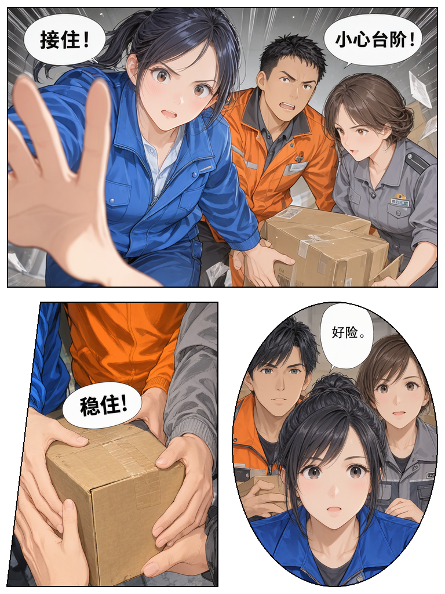

# Penna Comic（移植测试版）

**Penna Comic 是基于 [storyAura](https://github.com/storyAura) 开发的开源项目 [Penna（羽毛笔）](https://github.com/storyAura/Penna) 修改而来的衍生版本。原始 Penna 的开发成果与版权属于原作者及其贡献者。**

本仓库在原作基础上增加或调整漫画生产相关功能，包括 ComfyUI 接力、串行批量任务、LoRA 选择、台词传递、成品预览与导出，以及移植配置和打包。原作已有的工作台、提示词编辑与其他基础能力沿用上游实现；上面的扩展说明不代表整个项目由本仓库从零开发。

本版本由 [sugdiy1](https://github.com/sugdiy1) 维护，并参与功能规划、使用测试和反馈。与上游无官方从属关系，也不是原作者发布的官方版本。感谢 storyAura 及上游贡献者提供基础项目。

保留原始 [MIT 许可证与版权声明](LICENSE)：`Copyright (c) 2026 storyAura`。再分发时请一并保留 LICENSE、[第三方说明](NOTICE.md) 和相关字体许可。本版本与原版使用不同的数据目录。

## 已有功能

**开始使用：[.9版全功能图文教程](docs/图文操作教程.md)** · [离线HTML教程](docs/图文操作教程.html) · [既有详细操作指南](docs/操作指南.md) · [可导入的三格示例](docs/examples/parcel-rescue.layout.json) · [MOSS/Qwen 配套说明](docs/MOSS-QWEN.md)

- 区域分镜、角色/画风文本卡、多页编辑。
- 一次发起多页分镜任务，程序自动逐页执行；保存原始要求、页面摘要与进度，支持暂停后继续剩余页。
- 通过已有 ComfyUI 生成整页图，串行批量、保存任务、续跑和单页重做。
- 可逐格独立生成，按矩形、椭圆或多边形画框作真实蒙版拼接；支持单格换种子和缓存复用。
- 文字框台词直接交给 MOSS 生成，成品预览及 CBZ/PDF 导出；出图面板提供“终止任务”。
- 连接 OpenAI 兼容聊天服务。思考菜单适配本地 Bonsai，以及官方 DeepSeek 的 deepseek-flash / deepseek-v4-pro（关闭、低、高、最高）。上下文精确测量仍属于本地 Bonsai 专门适配；其他接口不保证这些扩展控件可用。
- 导入自己的 MOSS API 工作流时，按连接关系自动识别正面提示词和 LoRA；有歧义时选择并保存绑定。详见 [工作流导入与官方模板](docs/MOSS-QWEN.md)。
- TXT/EPUB 分卷分章；AI先准备文字角色、场景与道具资产，再逐页从121套布局中匹配并生成分镜、提示词和台词；支持单页改稿、接力出图、预览与导出。

## 外部 Agent 控制（DSH / MCP）

在“设置 → 漫画连接”打开“允许本机 Agent 控制 Penna”，将界面显示的 Python 命令及参数填入 DSH 的 stdio MCP 服务。DSH 可直接读写分镜页、确认保存、选择 LoRA、提交或取消单页/多页出图并查询结果、导出 CBZ/PDF，无需内置聊天模型参与。默认关闭，每次启动需手动启用。修改使用页面版本校验，冲突时重新读取。完整步骤见 [DSH 连接说明](docs/DSH-MCP.md)。出图期间请保持 Penna 运行；关闭连接不取消已提交任务。

## Windows 首次配置

需要 Windows 10/11 x64、已有 ComfyUI、已有 Python 3.10+ 和可用的聊天模型接口。

1. 完整解压发行ZIP，不要只复制 penna.exe。程序依赖同目录DLL和data资源。
2. 给选用的Python安装后端依赖：python -m pip install -r backend/requirements.txt。若使用ComfyUI已有Python，可先检查Pillow和psutil是否已装。
3. 在设置 → 漫画连接，选择真实Python可执行文件、设置ComfyUI地址和输出目录。工作流默认使用安装目录的 workflows/moss-api.json。
4. 点击“检查环境”。缺少MOSS支持、模型或节点时先解决提示；程序不自动下载模型或升级ComfyUI。
5. 在API管理添加自己的OpenAI兼容服务。需要本地模型时由用户预先启动。
6. 先用单页测试，确认文字框、LoRA和模型文件正确，再提交多页任务。

用户数据默认放在 %APPDATA%/PennaComic；不读取或迁移原版文档/Penna。可使用 PENNA_HOME 指定其他独立目录。
连接设置保存在该目录 integration.json；相对配置路径以它所在目录为基准。integration.example.json 只作格式示例，不会自动使用示例Python路径。
程序目录只含资源；任务/成品默认在用户目录的renders。不要把自己的数据目录放入公开仓库。

## 显存与模型管理

默认 external 模式：本程序不停止聊天服务、不卸载ComfyUI模型，也不替你配置显存。单卡显存不足时，先手动结束或卸载占显存的LLM，再出图；出图结束后手动启动LLM。

可选 managed 模式需在integration.json中明确配置 llama_executable、llama_model、完整 llama_args（字符串数组）、llm_url；只管理本程序启动且PID/创建时间/程序路径匹配的进程，不自动接管第三方已启动服务。它依赖NVIDIA nvidia-smi，默认启动前/后空闲显存门槛为13000/3072MiB，可用minimum_free_before_mib和minimum_free_after_mib调整。首次公开测试建议保持external模式。

## 工作流约定

仅支持随包提供的专用API图及保持接口约定的修改版，不接受任意ComfyUI图。关键节点ID：1基础模型、2采样配置、5正面、6负面、8采样器、11保存。
模板提供 MOSS UNET、Qwen文本编码器、VAE的示例文件名，须与本机模型列表一致。LoRA由面板选择替换模板LoRA链。默认不携带私人LoRA组合。

角色卡是文字提示约束，不是图像身份锁；跨页脸型、体型、服装仍可能漂移。已用正常着装的成年人物测试逐格生成、蒙版拼接、断点恢复和单格重画；这不代表所有题材、模型组合与画质均已验收。

## 开发与构建

本次验证使用 Flutter 3.47.2 / Dart 3.13.2；锁文件随源码提供。完整Windows构建需要Visual Studio的C++桌面开发工具以及Flutter桌面插件所需链接支持。缺失时不要把本机旧DLL与新app.so拼接当成干净构建。

- flutter pub get
- dart analyze lib test
- 设置 PENNA_TEST_PYTHON 为测试用Python绝对路径后，flutter test --concurrency=2
- 在backend目录执行 python -m unittest discover -p "test_*.py" -q
- pwsh tool/build_windows.ps1 -Python python

GitHub Actions配置见 .github/workflows/windows.yml；它仅生成候选构建产物，不自动创建公开Release。
默认禁用原项目更新来源；确有自己的发行仓库时，构建参数 -UpdateRepo owner/repo 可启用对应源。上传前需验证发行包格式与更新路径兼容。
源码白名单打包：python tool/package_release.py source --out release/PennaComic-source.zip。
每包附逐文件SHA-256清单，另生成ZIP哈希文件。不要上传build目录、模型、用户配置、日志、作品、原文或测试私有数据。

## 发布状态

这是移植候选版，并非已完成跨机器验收的正式版。请先检查 docs/VALIDATION.md 的实际通过与未验证项。原项目与字体/依赖许可见 LICENSE、NOTICE.md 及 font目录许可证。源代码已上传至 https://github.com/sugdiy1/PennaComic （公开仓库）；Windows候选包已在Actions完整构建并通过本机启动检查，未发布Release。

## MOSS 接 Qwen 修改（1.1.0-comic.6）

一键接力中可选「MOSS 生成」「MOSS 生成后由 Qwen 修改」「只修改已有图片」。支持填写修改要求、保留原稿和批量生成后修改，详见 [使用与模型配套](docs/MOSS-QWEN.md)。

## 自动多页与逐格拼接（1.1.0-comic.7）

直接要求“按这个故事生成15页漫画分镜”，程序会自动分成单页调用；失败或停止后可继续剩余页。同系列新开聊天或重启后保留任务进度，重启不会自动调用模型。聊天历史默认预算为32000字符、最多24条；任务原文与已完成页摘要单独保存。该预算不等于模型 token 上限，不会修改本地模型服务的上下文容量。

出图模式选择“逐格生成并蒙版拼接”，勾选真正的漫画格画框；台词仍由模型绘制，程序只合成格图。详细设置见 [逐格拼接与多页说明](docs/MOSS-QWEN.md)。15页自动执行与恢复通过模拟模型测试；真实本地模型连续15页的创作质量尚未验证。

## 实际生成的漫画样张

正常着装的成年快递员合作接住货物，包含多人动作、手部特写和多人面部特写。三个漫画格分别生成，再按矩形、斜切多边形和椭圆蒙版拼接；中文台词由 MOSS 绘制，程序不排字。

[查看原尺寸](docs/images/parcel-rescue-original.png) · [仅重画第一格后的对照图](docs/images/parcel-rescue-panel1-redraw.png) · [测试参数与完整操作步骤](docs/操作指南.md#9-实际测试图片与参数)

实测包括中断续跑、相同任务零新增出图、单格换种子后只提交一格。人物与手部细节仍需人工检查，样张不构成画质或角色一致性保证。

## 小说AI资产与自动排版（1.1.0-comic.8）

在“小说漫画”导入TXT/EPUB，设置中选择API管理已有的AI连接，依次“准备资产 → AI自动排版”，然后在**自行复制提示词 / 用我的工作流出图**之间二选一。内置121套布局，覆盖15类构图的比例/重心变体及整页，AI按事件、情绪和连续性选择，显示选择理由。文字资产卡分开记录原文证据和视觉补设，支持手工编辑与别名归并；这约束文字设定，不代表出图锁脸。

详细步骤、续做方式与验证边界见 [小说AI操作说明](docs/NOVEL-AI.md)。新界面不自动启动本地模型，模型连接由用户选择。Luna子代理已实际产出两页文字方案用于导入测试；本轮没有完成外部云端API的端到端创作或新的漫画成图验收。
