# PennaComic 全功能图文操作教程

适用版本：**1.1.0-comic.10**（截图来自 comic.9，思考档位变化见第 21 节）。第 1～18 节介绍小说漫画生产流程；第 19～40 节逐项介绍工作台、区域控制和其他功能。可用左侧目录直接跳转。

本软件基于 **storyAura/Penna** 修改，由 **sugdiy1** 维护；不是上游官方版本。原作、版权与第三方许可见包内 README、NOTICE.md、LICENSE 和字体许可。分发时请保留这些文件。

## 1. 先理解三个阶段

| 阶段 | 你得到什么 | 是否需要 ComfyUI |
| --- | --- | --- |
| 准备资产 | 角色卡、场景卡、道具卡、剧情摘要 | 不需要 |
| AI 分镜排版 | 页面布局、各格画面描述、镜头、台词和提示词 | 不需要 |
| 工作流出图 | 成品 PNG，再导出 CBZ/PDF | 需要 |

前两个阶段使用你在 API 管理中配置的 AI 服务。选择云端服务时，小说片段与相关角色资料会发给该服务，调用费用按服务商规则计算。软件不提供免费额度或内置密钥。

**画布里出现分格和文字，并不代表成品图片已经生成。** 图片出现“画面待生成”时，当前完成的是分镜设计。

教程截图来自独立数据目录中的真实 .9 版界面，API 地址为占位示例，没有密钥。小说部分使用先前 Luna 创作的成年快递员文字方案；全功能部分使用仓库公开的正常着装成年人物三格布局与演示文字。截图过程没有调用云端 AI、没有提交 ComfyUI 出图。角色卡中的“证据待核对”是实际提示，不能当作原文已验证。第 15 节另附历史成品测试样张，不与小说两页布局一一对应。

## 2. 解压、启动与升级

1. 将 Windows 使用版 ZIP **全部解压**到一个独立文件夹，例如 `D:\PennaComic`。
2. 确认里面有 `penna.exe`、DLL、`data`、`backend`、`workflows`、`docs`。不能只拿走 EXE。
3. 双击 `penna.exe` 启动。此发布包不附带 Python、ComfyUI、模型权重或 LoRA。
4. 第一次使用先配置 API；如果只想复制提示词，可以暂时不连接 ComfyUI。
5. 升级时先保存并正常关闭旧版，把新版解压到另一个目录，再使用相同数据目录启动。不要让两个版本同时写入同一数据目录。

**程序目录与数据目录不同。** 默认数据目录是 `%APPDATA%\PennaComic`。使用快捷方式中的 `--home` 参数或环境变量 `PENNA_HOME` 时，以实际指定的目录为准。当前这台电脑的路径另见交付目录里的“本机使用说明”，不要把自己的路径照搬给别人。

需要指定数据目录时，在 Windows 快捷方式的“目标”中填写类似内容：

```text
"D:\PennaComic\penna.exe" --home "D:\PennaComic-data"
```

## 3. 配置云端 AI：显示名称和模型名要分开

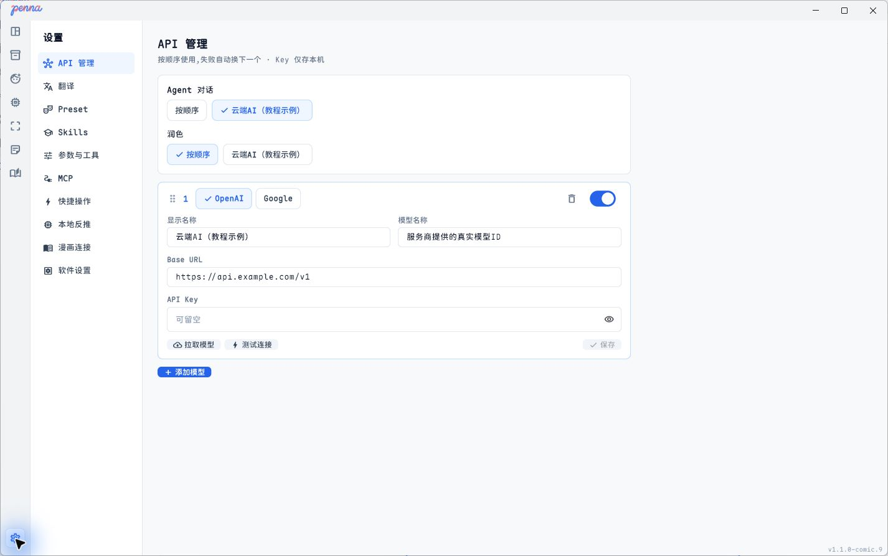

1. 点击左下角齿轮，进入 **设置 → API 管理**。
2. 点击“添加模型”，按服务商要求选择 OpenAI 兼容或 Google 协议。
3. “显示名称”可以写自己容易辨认的名字，例如“我的云端分镜”。
4. **“模型名称”必须填写服务端支持的实际 ID**，不能填昵称、人物名或自定义中文备注。
5. Base URL 填服务商给你的完整接口地址。图中的 `https://api.example.com/v1` 仅作示意，不能调用。
6. 填入自己的 API Key，保存连接并启用右上角开关；有“测试连接”时可先验证。
7. 在上方 Agent 对话区域选中该连接。然后到小说设置中选择它，或选择“跟随 API 管理中当前选中的连接”。

本机此前的服务曾明确返回支持 `deepseek-flash`、`deepseek-v4-pro`，而不支持“大肥鱼”。如果你连接的是同一服务，可填它实际支持的 ID；其他服务以自己的模型列表为准。**不要把“大肥鱼, deepseek-flash”当成一个可用模型名。** 小说模块使用列表中的第一项，不应依靠第二项自动兜底。

删除旧连接、重新添加后，其内部 ID 会变化。此时应重新打开小说设置，**明确选择一次新连接或“跟随当前连接”，再保存**。仅看到下拉框显示“跟随”不代表旧绑定已经清除。

## 4. 配置 Python、ComfyUI 与输出目录

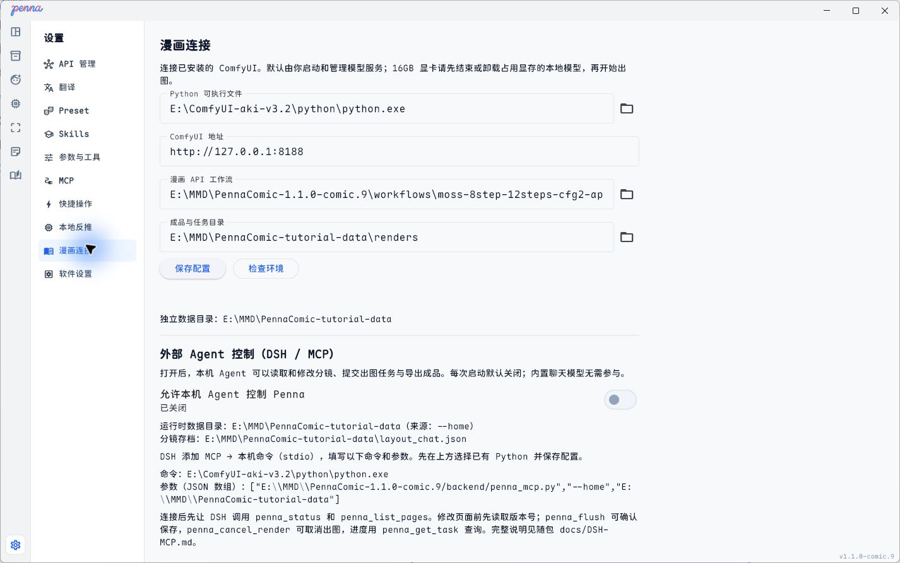

进入 **设置 → 漫画连接**，按下表填写：

| 项目 | 应该填写什么 | 常见错误 |
| --- | --- | --- |
| Python 可执行文件 | 已安装 Python 的 `python.exe`，也可使用现有 ComfyUI Python | 只填目录；填到不存在的 runtime 路径 |
| ComfyUI 地址 | 运行中的 ComfyUI 地址，常见为 `http://127.0.0.1:8188` | 把聊天模型地址填到这里 |
| 漫画 API 工作流 | 兼容的 MOSS **API 格式** JSON | 用可视化界面格式 JSON 直接替代 |
| 成品与任务目录 | 有写入权限、空间足够的目录 | 换目录后忘记旧成品在哪 |

1. 点击“保存配置”。
2. 使用“检查环境”确认 Python、连接、模型文件名和节点是否匹配。
3. 现有环境满足依赖就直接使用；本机无需为本教程重装 ComfyUI、升级节点或下载模型。
4. 迁移到新电脑且确实缺依赖时，可用选定的 Python 安装包内 `backend/requirements.txt`。后端依赖为 Pillow、psutil；不能只给另一个 Python 安装。

新电脑的依赖安装命令示例，路径必须自行替换：

```powershell
& 'D:\Python\python.exe' -m pip install -r 'D:\PennaComic\backend\requirements.txt'
```

即使选择“自行复制提示词”，TXT/EPUB 解析仍需要有效的 Python 和后端入口。小说设置下方 **“本地后端”** 里的 Python 路径应指向同一可用环境，`launcher.py` 路径应指向当前程序目录的 `backend\novel_launcher.py`。

默认 external 模式由你管理模型服务。使用云端 AI 不会占用本地 LLM 显存；若其他本地模型也在运行，出图前请自行处理显存占用。教程不要求开启本机 Agent 控制或改变安全设置。

## 5. 导入 TXT / EPUB，认识小说漫画页面

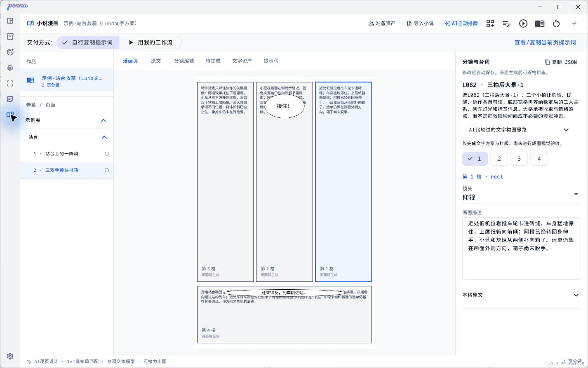

1. 点击最左侧书本图标，打开 **小说漫画**。
2. 点击右上角“导入小说”，选择本地 TXT 或 EPUB。
3. 导入后在左侧选中作品。卷、章与页面将在这里管理。
4. 再次导入同一小说可能形成另一个作品，不是继续已有进度的必要步骤。暂停后优先选中原作品续做。

界面定位：

- **左侧**：作品、卷章与页面；点页名切换当前页。
- **上方工具栏**：准备资产、AI 自动排版、布局目录、单页 AI 修改、一键接力、成品预览、重新规划、设置。
- **中间标签**：漫画页、原文、分镜编辑、待生成、文字资产、提示词。
- **右侧**：布局编号、选择理由、逐格镜头、描述和台词。
- **交付方式栏**：自行复制提示词 / 用我的工作流，随时可切换。

## 6. 设置每章页数、画风和创作要求

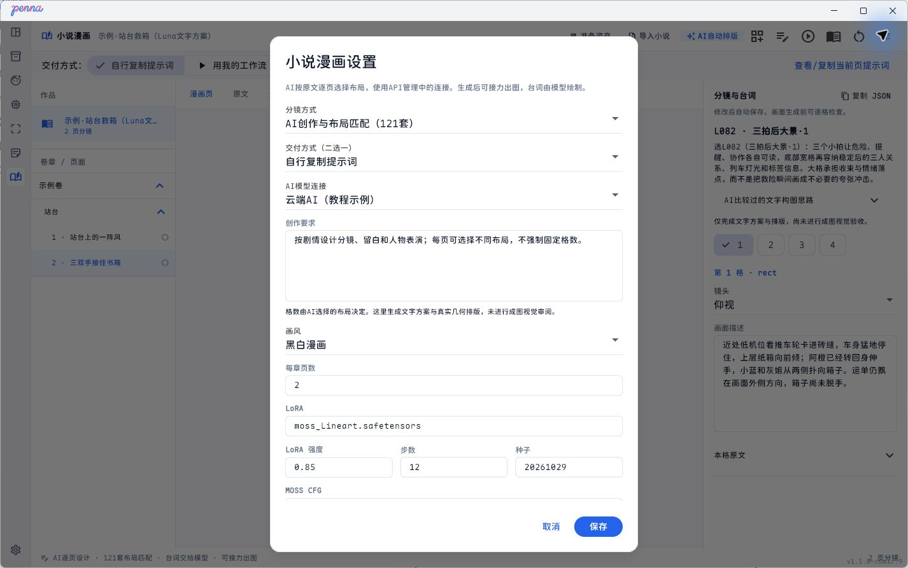

点击右上角滑杆图标：

1. 分镜方式选 **“AI创作与布局匹配（121套）”**。
2. 交付方式先选“自行复制提示词”或“用我的工作流出图”。后面也可以切换。
3. AI 模型连接选择第三节配置的可用云端连接。
4. 填写画风与每章页数。**每章 2 页不等于整本只有 2 页**；整本总页数取决于解析出的章节数。
5. 在创作要求中明确节奏、读序、台词和艺术倾向，点击“保存”。

可复制的创作要求示例：

```text
保持已确认的角色姓名、发型与基础服装；场景变化和换装写入当前格。
按故事节奏选择布局：铺垫时留白，冲突时突出动作，转折处给反应或翻页钩子。
允许有目的地重复构图，不要为了变化随机换景别。
每格只描述一个清楚的动作瞬间，多人画面写清谁在左、谁在右、谁说话。
台词简短，保留必要的原文信息，不添加与剧情无关的独白。
```

AI 模式的格数由所选布局决定，包含 1～6 格；不是强制每页四格。若希望对白密集场景用 4～6 格，可写进创作要求，但仍需检查实际结果。

原文会按段落/句子附近连续分到指定页数中。单页原文超过限制时，需要增加每章页数，不会自动把超出部分悄悄截去。设置改变后若与旧计划不一致，按第 13 节处理。

## 7. 先准备文字资产，再检查角色卡

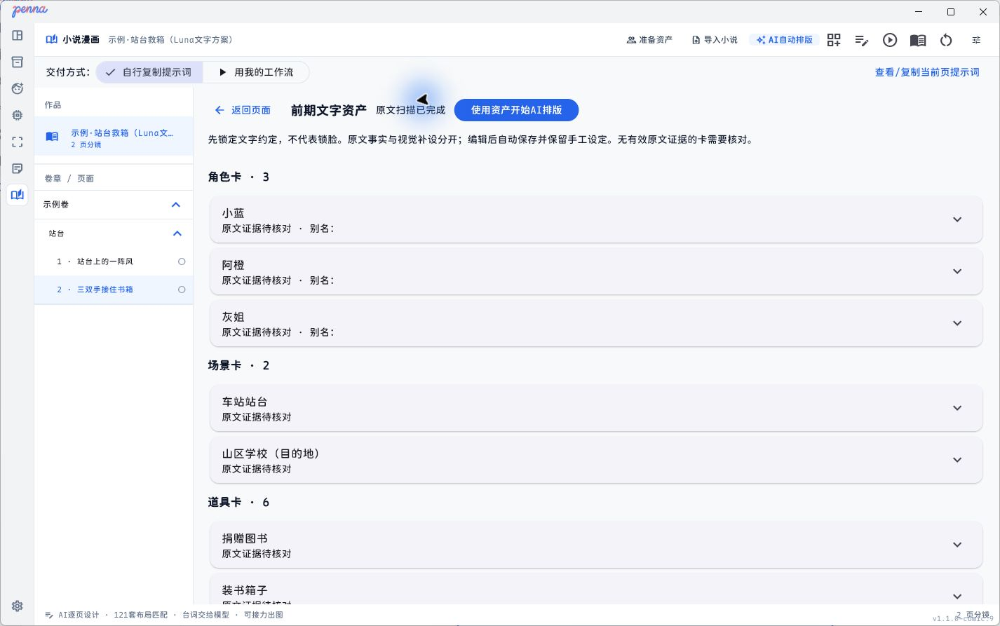

1. 点击上方 **“准备资产”**。程序分段扫描小说，识别角色、别名、地点、关键道具和事件摘要。
2. 每段完成即保存；扫描中途暂停后，仍可继续未完成的段。
3. 完成后打开“文字资产”，逐个展开角色卡，先核对主角和重要配角。
4. 修改字段后自动保存。手工修改的设定会用于后续页和新的出图快照。

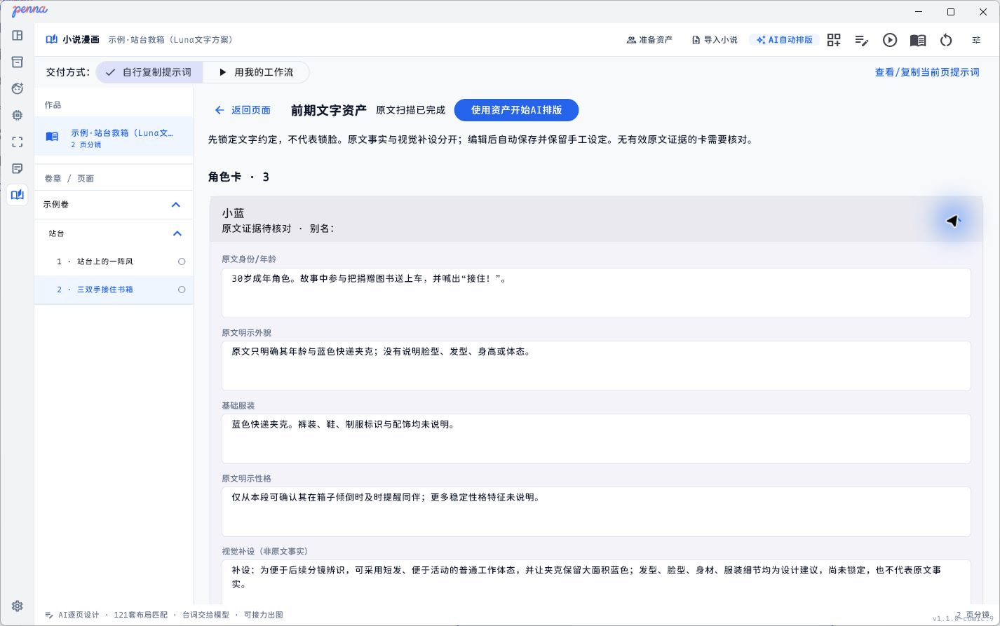

角色卡检查顺序：

1. **姓名与别名**：同一个人是否被拆成两个人？不同角色是否误共用了泛称？
2. **身份/年龄**：原文没有说明的不要当作确定事实。
3. **外貌与基础服装**：头发、眼睛、服装颜色等长期特征要统一。
4. **视觉补设**：原文没有脸型、发型时，可在此补充设计，但不要写成原文明示。
5. **证据与待核对提示**：证据能在原文匹配，不代表所有推断都正确；仍需人工检查。

当前先做的是“文字约定一致性”。**它不等于图像锁脸**。跨页脸型、体型和服装仍可能漂移，成图后必须看图检查；参考图或角色 LoRA 的配合需使用对应工作流能力。

## 8. AI 自动分镜与 121 套布局

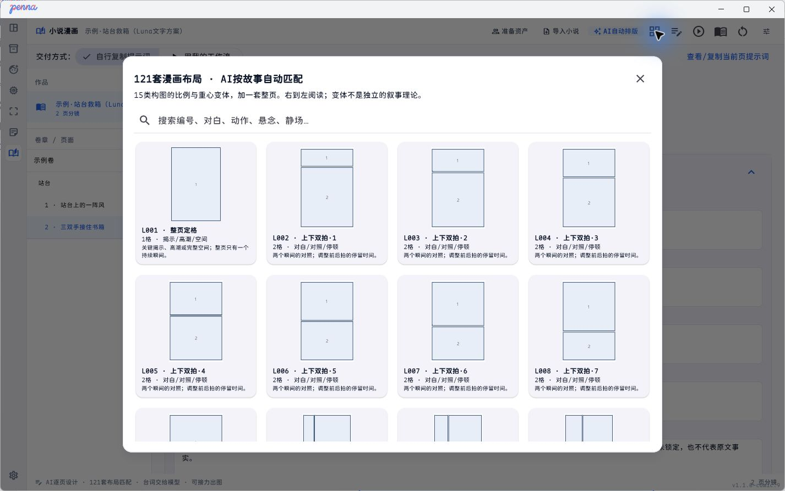

1. 资产检查后点击“使用资产开始 AI 排版”，或回到主界面点“AI自动排版”。
2. 如果资产尚未完成，程序会先继续资产扫描，再逐页做分镜。
3. 每页完成后保存页面 JSON 和状态，再进入下一页。
4. 选择左侧页名，查看布局编号、选择理由、文字构图备选和独立格描述。
5. 阅读右侧逐格内容，确认出场角色、空间关系、动作连续、台词归属。

目录是 **15 类构图各 8 种几何变化，加 1 套整页布局**，不是 121 种独立叙事理论。包括上下双拍、左右对峙、主画面、对白反应、斜切和嵌入细节等。程序按编号生成真实坐标；模型自己输出一个不存在的编号或漏写画格时，会暂停，不静默退回四格模板。

当前布局目录主要用于浏览，具体布局由 AI 选择。**文字备选不是已经画好的视觉草稿**，需要你对实际叙事与成图做判断。

## 9. 出口 A：自己复制提示词

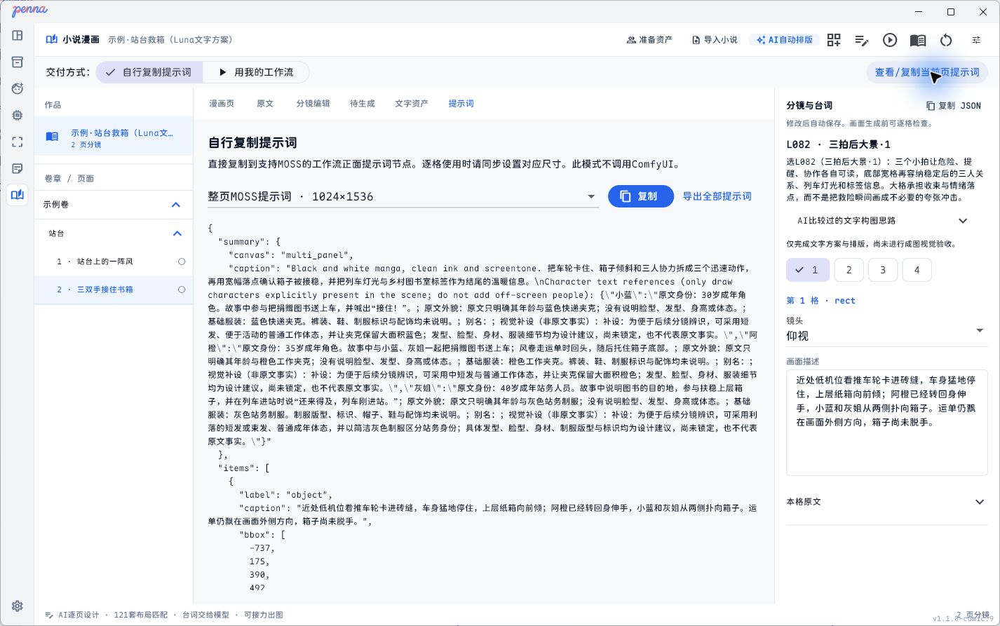

1. 交付方式选 **“自行复制提示词”**。
2. 点“查看/复制当前页提示词”，或进入“提示词”标签。
3. 下拉框选择“整页MOSS提示词”“第 N 格”或“台词清单”。
4. 点“复制”，把完整内容粘贴到支持 MOSS 布局的工作流正面提示词节点。
5. 手动同步设置对应的画幅；每格尺寸会显示在下拉框里。
6. 需要交给其他软件或 AI 时，点击“导出全部提示词”，选择目录。输出每页的 JSON、Markdown 及索引说明。

此出口不提交 ComfyUI。整页 bbox 只是模型的构图提示，不是硬遮罩；若需要精确格形，使用下节的逐格蒙版拼接。

## 10. 出口 B：使用自己的 MOSS 工作流

comic.10 新增“导入 API 工作流”和“识别 / 修改绑定”：不再要求固定节点编号。首次导入检查正面提示词入口、最终输出、采样器与 LoRA 后保存；存在多个候选时手选，后续按文件指纹复用。界面格式 JSON 请先在 ComfyUI 导出 API 格式。原生、rgthree Power LoRA、LoraManager 固定列表可读；未知管理器可选择保留原工作流 LoRA。详细边界和步骤见 `docs/MOSS-QWEN.md`。下方截图来自 comic.9，未显示新增按钮。

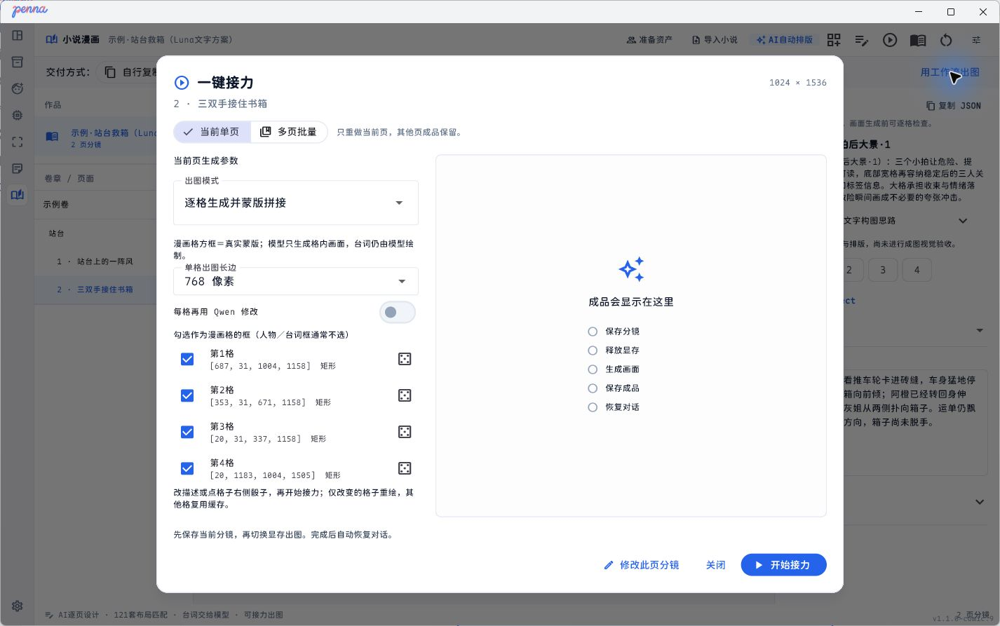

1. 在小说设置中选“用我的工作流出图”，通过文件选择按钮指定兼容的 MOSS API JSON。也可留空，沿用“漫画连接”工作流。
2. 返回页面，点“用工作流出图”或工具栏的一键接力图标。
3. 先选 **“当前单页”**，确认内容后再扩大到批量。
4. 出图模式选 **“逐格生成并蒙版拼接”**。每格分别生成，再按真实画框合成整页。
5. 只勾选作为漫画格的画框，不把人物框、物件框和文字框当成单独画格。
6. 单格长边可按工作流与显存情况设置。截图演示为 768 像素，不是所有硬件的通用要求。
7. 核对 LoRA、强度、步数、CFG、种子与工作流路径。
8. 确认后再点 **“开始接力”**。本教程截图没有点击该按钮，因此不是新一轮出图验收。

工作流兼容约定：关键节点为 `1 UNETLoader`、`2 ModelSamplingAuraFlow`、`5/6 CLIPTextEncode`、`7 EmptyFlux2LatentImage`、`8 KSampler`、`11 SaveImage`；模型 LoRA 链使用 `LoraLoaderModelOnly`。节点编号、类型不符合时不能直接套用，也不自动猜测任意图的接线。

可先用包内 `workflows/moss-8step-12steps-cfg2-api.json`。ComfyUI 可视化界面的 JSON 与 API 格式 JSON 不同，不能只改文件名。

**台词由 MOSS 绘制，不做程序中文排字。** 文字框给出内容和位置，最终仍应检查错字、漏字、重复台词与说话人归属。

## 11. 多选 LoRA、8 步加速与实际 12 步

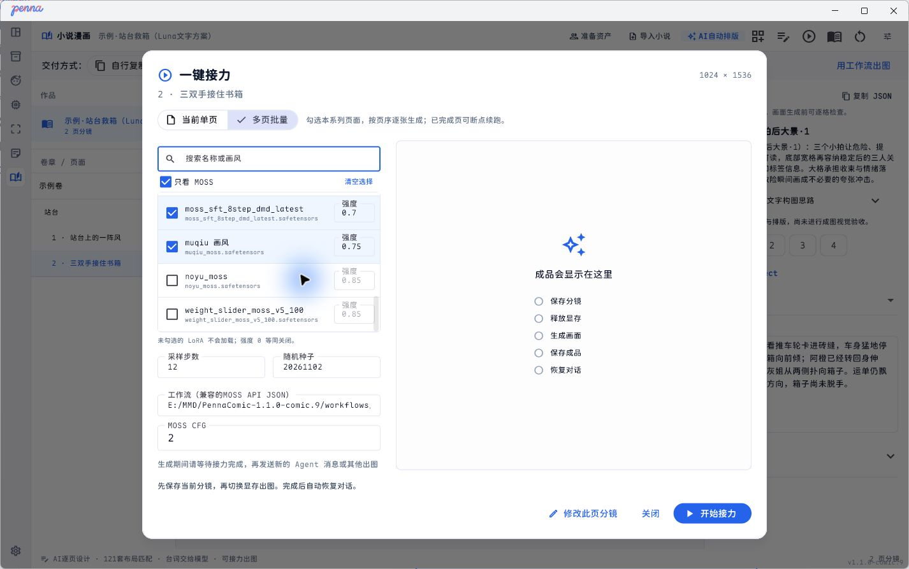

1. 在接力面板中向下滚动，找到“LoRA 多选”。
2. 用搜索框查找本机模型，或滚动列表；没有的文件不能只手填一个名字假装存在。
3. 勾选需要的 LoRA，分别修改右侧强度。未勾选不加载，强度 0 相当于关闭。
4. 选择工作流后，程序会读取其中的采样参数与 LoRA 默认链；同一路径文件内容变化时会重新识别。
5. 默认值读入后仍可手动调整。修改参数会影响后续任务，不会自动把已经出好的页全部重画。

本包加速示例的实际设置：

| 项目 | 示例值 |
| --- | --- |
| 加速 LoRA | `moss_sft_8step_dmd_latest.safetensors`，强度 0.7 |
| 画风 LoRA | `muqiu_moss.safetensors`，强度 0.75 |
| 采样步数 | **12** |
| CFG | **2** |

“8 步加速”是 LoRA 的训练/用途名称，不等于软件会忽略你填写的实际步数。本示例按当前设定执行 12 步。换成普通 MOSS、其他加速权重或别的模型后，不要机械沿用这一套参数。模型权重与 LoRA 需自行准备，发布包不包含它们。

## 12. 多页批量、精确拼接与单格重画

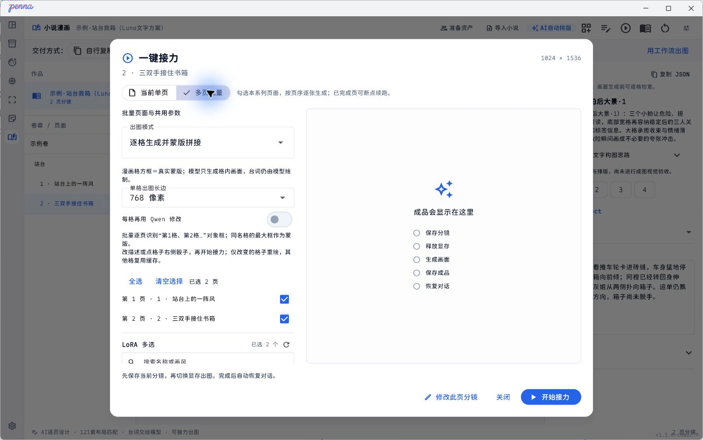

1. 打开一键接力，切换 **“多页批量”**。
2. 勾选需要生成的页；可用“全选”或“清空选择”。
3. 核对批量共用参数，确认顺序后开始。
4. 任务按页、按格串行执行，不同时塞满多个显存任务。
5. 相同快照和参数的已完成内容可利用缓存续跑；描述、台词、种子等变化会影响缓存匹配。

精确拼接时，漫画画框是程序蒙版：矩形、椭圆和多边形按实际坐标裁剪合成。模型负责格内画面，不负责决定最终硬边界。

单格错误时，回到当前单页：只修改出错格的描述/台词，或使用该格旁的换种子按钮；再开始接力。未变化且缓存匹配的格可复用。不要为了修改一只手就先重新规划整本小说。

生成中需要停止时使用面板的“终止任务”。停止后的完成结果保留；再次开始前检查状态，不重复同时点击多次提交。终止按钮只在任务运行时出现，所以静态参数截图中看不到。

## 13. 修改当前页、暂停续做与重新规划

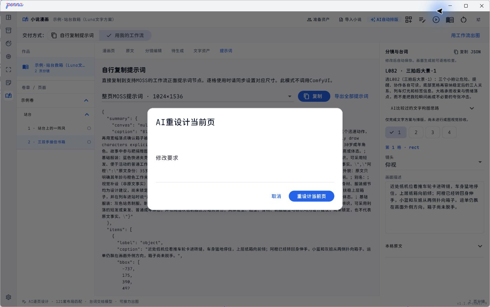

**手工改一格：** 选中左侧页面，在右侧格号中选格，修改描述、镜头或台词，自动保存。

**AI 改一页：** 选中页后，点击工具栏的铅笔图标“AI重设计当前页”，填写明确要求，例如：

```text
保留现有剧情和角色基础服装。
把接住书箱的瞬间做成主画面，加强多人手部动作和视线关系。
减少无关台词，保留“接住！”，不要修改其他页面。
```

提交前程序会保存该页的修订副本。其他页不会一起重做，但改完要检查前后页的连续性。AI 改稿需要一次新的模型调用。

**暂停后继续：** 使用 AI 任务停止按钮；已完成的资产段与页保留。重新启动软件不会自动调用模型，手动选择同一作品，再点“准备资产”或“继续AI排版”接续。

**重新规划：** 修改原文、每章页数、画风或创作要求后，旧计划签名不匹配时，需要使用“重新规划”新建一轮。旧页面文件保留，但当前轮次的页列表会切换。它与“继续剩余任务”不是同一操作。

## 14. 成品预览与 CBZ / PDF 导出

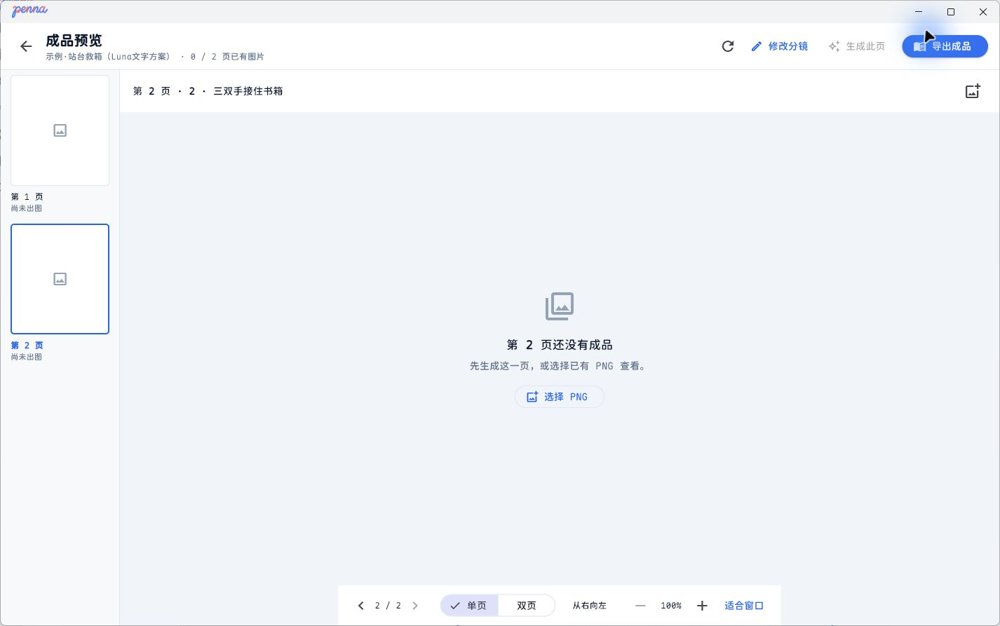

1. 完成出图后点击上方书本图标，打开 **“成品预览与导出”**。
2. 左侧选择页面，检查图片、台词、裁切和页序。
3. 下方可切换单页/双页、阅读方向和缩放。
4. 页面没有成品时会像图 13 一样显示“还没有成品”。可回去生成此页，或用“选择 PNG”导入自己已完成的整页图片。
5. 多个版本时选择希望导出的版本；需要修改布局可用“修改分镜”，需要重画可用“重做此页”。
6. 点击右上角 **“导出成品”**，在导出面板确认页序、成品版本、名称、格式和输出目录，再执行导出。
7. **CBZ** 用于漫画阅读器，保存按序排列的漫画图片；**PDF** 方便一般阅读、传阅或打印查看。二者都需要已有成品图，不会在导出时自动补画缺页。
8. 导出后实际打开文件检查首尾页、阅读顺序与缺页情况。保存原始 PNG，便于以后重编。

图 13 特意展示“缺少图片”的真实状态，避免把分镜框当成成品。没有成品图时不能通过点击导出凭空得到完整漫画。

## 15. 已有成品样张与质量检查

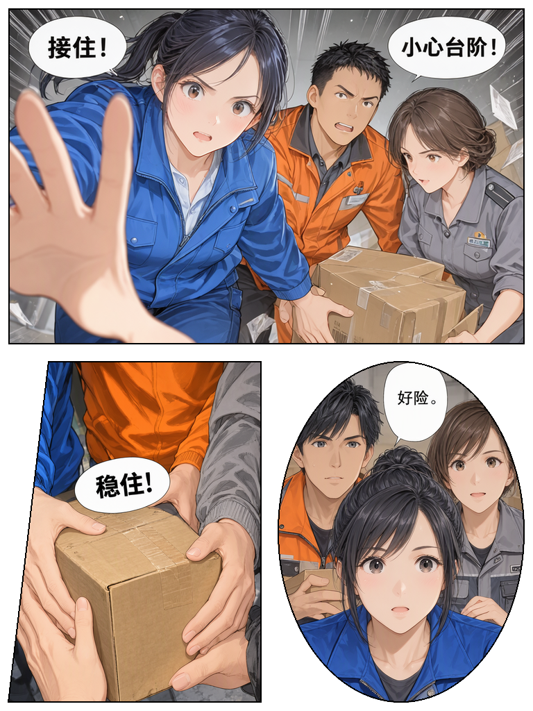

上图是仓库已有的三格测试成品，并非本教程两页 Luna 布局的新渲染结果。可导入布局为 `docs/examples/parcel-rescue.layout.json`；测试条件与单格重画对比见旧版详细操作指南。不要把历史测试使用的 50 步/CFG3 与本包 8 步加速示例的实际 12 步/CFG2 混为一套设置。

交付前逐页检查：

- 人物姓名、出场人数、发型、服装是否连续。
- 多人近景是否串脸，手部、视线、肢体连接是否错误。
- 动作前后是否有因果，场景方向是否突然反转。
- 台词是否与分镜一致，有无错字、漏字和多余文字。
- 格形、画面裁切、阅读顺序和翻页节奏是否清楚。
- 导出的 CBZ/PDF 是否使用了正确的成品版本。

## 16. 常见报错：按报错层级处理

| 报错/现象 | 原因与处理 |
| --- | --- |
| 请选择可用 AI 连接 | 进入 API 管理启用有效连接；小说设置重新明确选择它或“跟随当前连接”并保存。重建连接后旧 ID 可能失效。 |
| 400，模型名不支持 | 用服务端实际支持的模型 ID，中文备注放在显示名称。先检查模型列表第一项。 |
| Python 和后端入口不可用 | 小说设置展开“本地后端”，核对 `python.exe` 与当前安装目录 `backend\novel_launcher.py`；不要指向 Flutter SDK 或不存在的 runtime。 |
| Unexpected character / JSON 语法错误 | .9 会处理字符串外尾逗号，并在其他语法错误时自动纠错一次；仍失败会保留进度并暂停，可重试当前段。网络失败、取消、布局字段错误不走这个语法重试。 |
| AI 格数与布局不一致 | 模型返回的 panels 数量与布局编号不符。重试本页或调整要求；程序不会悄悄换成四格。 |
| 单页原文超过限制 | 增加每章页数并按提示重新规划，不要删除正文来掩盖问题。 |
| 工作流不兼容/占位符未识别 | 核对 API 格式、节点接口和模板占位符。先使用包内兼容模板，任意自定义图不会自动适配。 |
| 缺 LoRA、模型或节点 | 比对 ComfyUI 实际文件名与节点清单；改正选择，不要只改成一个不存在的文件名。 |
| ComfyUI busy | 仍有正在执行或排队的任务。等待或由你处理队列，再切换/提交；不要连续重复点开始。 |
| OOM/显存不足 | 减小单格尺寸，保持串行，处理同卡上其他模型占用；不要把显存不足当成提示词问题。 |
| 预览没有图片 | 分镜已完成但未生成，或当前数据/输出目录与原任务不同。先核对路径与成品版本。 |
| 升级后作品不见了 | 检查快捷方式 `--home`、环境变量与实际数据目录；不要用空目录覆盖原资料。 |

自动语法纠错会增加一次 API 请求，模型端可能产生额外费用。它不保证纠错后的故事与艺术质量，仍需要检查角色和台词。

## 17. 文件在哪里、如何备份和分发

| 内容 | 保存位置 |
| --- | --- |
| 程序与工作流 | 解压目录的 `penna.exe`、`backend`、`workflows` |
| 用户配置 | 实际数据目录的 `config.json`、`keys.dat`、`integration.json` |
| 小说工作区 | 实际数据目录的 `novel-comic\workspace.json` 与作品目录 |
| 角色/场景/道具 | 对应作品输出目录的 `assets.json` |
| AI 页计划 | 对应作品的 `ai\轮次\pNNNNN\page.json`、状态 manifest |
| 成品与渲染任务 | “漫画连接”配置的输出目录 |
| 导出的提示词/CBZ/PDF | 导出时自己选择的目录 |

备份时保存实际数据目录、小说原文件、作品引用的外部文件以及成品输出目录。不要只备份 EXE。路径在迁移到另一台电脑后需重新检查；密钥存储迁移后可能需要重新填写，不保证直接跨机器可用。

公开分发只使用发布包，不要压缩你自己的整个数据目录。发布包不应包含 API 密钥、私有小说、聊天记录、角色库、任务快照或模型权重。模型和 LoRA 的使用/分发许可需另行遵守。

## 18. 第一次操作的简短顺序

1. 完整解压，启动软件，确认 .9 版。
2. 配好一个有效云端 AI 连接，模型名用真实 ID。
3. 配好现有 Python；要出图时再确认 ComfyUI 和 MOSS 工作流。
4. 导入一本小说，每章先设 2 页验证流程。
5. 准备资产，人工检查角色卡。
6. AI 自动排版，逐页检查剧情、布局、描述与台词。
7. 选“复制提示词”，或选“用我的工作流”。
8. 工作流模式先完成一页，再多页批量。
9. 对错误格单独修正，检查所有成品。
10. 在成品预览中导出 CBZ/PDF，再实际打开检查。

进一步说明：`docs/NOVEL-AI.md`、`docs/操作指南.md`、`docs/MOSS-QWEN.md`、`docs/DSH-MCP.md`。旧指南保留旧版测试条件；小说资产与双出口操作以本图文教程和 NOVEL-AI.md 为准。

## 19. 左侧导航：各个页面分别做什么

左侧竖栏由上到下是工作台、档案库、角色库、本地反推、区域控制工作台、记事本、小说漫画；最下方齿轮是设置。鼠标悬停图标可看名称。

| 页面 | 主要用途 | 常见入口/结果 |
| --- | --- | --- |
| 工作台 | 写、改、整理普通图像提示词 | 左边成稿，右边聊天，底部最终提示词 |
| 档案库 | 保存可重复使用的整条提示词或布局 | 分类浏览、复制、放回 |
| 角色库 | 保存常用人物名称、提示词和参考图 | 我的、内置、收藏 |
| 本地反推 | 从已有图片提取标签或描述 | Tag、NL、LLM 三种反推 |
| 区域控制 | 手工摆框，与 Agent 共同设计空间布局 | MOSS Layout、接力、成品预览 |
| 记事本 | 记录设定、对白草案与检查清单 | 多个本子，每本多条笔记 |
| 小说漫画 | 小说资产准备与 AI 分镜生产 | 第 1～18 节介绍的完整流程 |
| 设置 | 管理模型连接、翻译、提示规则、工具与外观 | 第 33～39 节 |

**这几处资料有独立的作用域。** 工作台和区域控制各有自己的对话；小说漫画有独立作品与资产。切换页面不等于把所有内容自动同步过去。

## 20. 工作台：成稿编辑与最终提示词

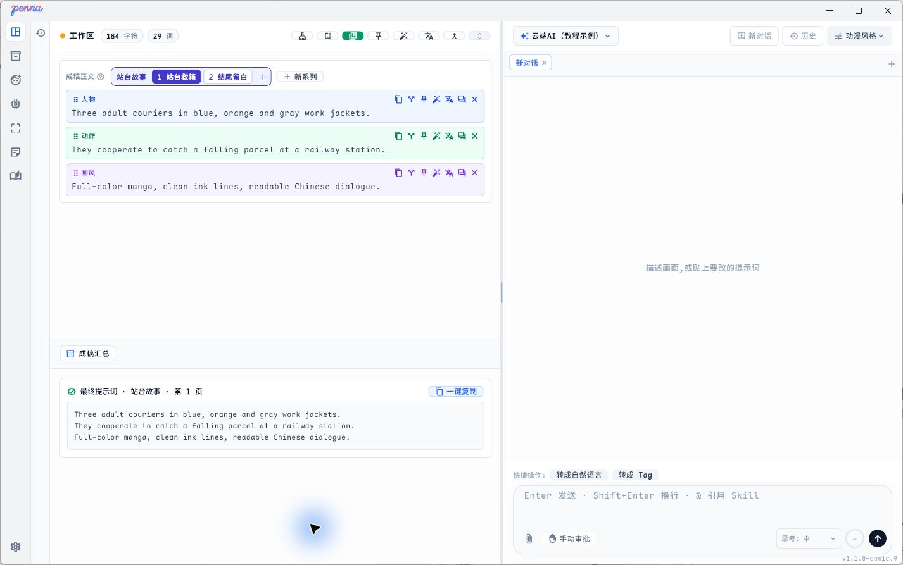

工作台适合一张插画、封面或一条提示词的精修。右侧告诉 AI 需求，左侧保留当前成稿，不必从聊天记录里反复寻找最后一版。

| 按钮/区域 | 用途 | 操作注意 |
| --- | --- | --- |
| 顶部字符/词统计 | 了解成稿长度 | 不是模型服务的 token 上下文容量 |
| 清空 | 清理当前成稿，开始新内容 | 先保存需要保留的稿件 |
| 保存 | 将成稿存进档案库 | 可填写名称与分类；保存系列用于系列各页 |
| 固定 | 固定选中文字，或新增固定片段 | 用于保留关键角色/画风文字；仍检查最终改动 |
| 润色 | 改写选中片段，未选中时处理整栏 | 会使用相应模型服务 |
| 翻译 | 为选中内容或成稿提供翻译 | 引擎在设置中配置，不是免费本地运算的保证 |
| 合并 | 将分段稿合成连续文字 | 适合最终投喂前整理；保留原稿副本更方便修改 |
| 展开/收起 | 显示或隐藏分段中文对照 | 不会提升图像模型的文字能力 |
| 段落右上角图标 | 复制、固定、润色、翻译、讨论、删除等 | 先看悬停提示，动作通常只针对这一段 |
| 最终提示词/一键复制 | 查看和复制整理后的提示词 | 分段标题、中文对照等界面辅助内容不一定进入最终提示词 |

示例用法：先写人物、环境、动作和画风，再只选中“动作”段要求强化动势。这样比反复重写整段更容易保住人物和配色。

## 21. 聊天、系列、历史、思考和上下文

工作台和区域控制右侧的聊天区域外观相近，但不是同一场对话。向区域控制 Agent 提的要求会围绕当前布局处理，不应假定普通工作台的所有聊天已经同步给它。

| 控件 | 实际作用 |
| --- | --- |
| 模型下拉框 | 切换已启用的 API 连接；模型 ID 必须真实有效 |
| 新对话、标签加号 | 新建聊天标签，不等于新建漫画页 |
| 历史 | 找回保存的对话；与档案库的成稿收藏不同 |
| 右上角风格/Preset | 切换当前 Agent 的工作规则与写词倾向 |
| 输入框回形针 | 添加图片或文件，消耗输入上下文；图像理解需要模型支持 |
| `@` 引用 Skill | 把指定技能作为当前任务的辅助规则 |
| 转成自然语言/转成 Tag | 将快捷指令接入输入框，检查后发送 |
| 自动审批/手动审批 | 控制是否直接采纳成稿改动；不是系统管理员授权 |
| 发送/停止 | 开始请求或停止当前生成；停止出图使用接力面板的终止任务 |
| 思考档位 | 对已适配模型传递思考相关设置，不能把任意服务变成同一种推理模型 |
| 上下文圆环/状态 | 已适配场景中显示容量和使用情况；不能代替服务端真实配置 |

截图来自 comic.9，当时云端思考控件不可操作。comic.10 起，API 管理中选择官方 DeepSeek 连接（主机 api.deepseek.com，OpenAI 协议，模型 deepseek-flash 或 deepseek-v4-pro），输入框旁可选择“关闭、低、高、最高”。菜单只在没有生成任务时可调；设置用于后续聊天、小说文字资产与逐页分镜。旧“中”和“极高”按官方规则映射为“高”，需要更强的思考可手动选“最高”。最高档通常更慢，消耗更多输出 token；不能保证分镜更好。

本地 Bonsai 仍为原来的五档。其他接口尚未适配时显示灰色，并提示“当前接口或模型尚未适配思考调节”。云端上下文圆环不因此获得精确容量测量。接口参数说明见 [DeepSeek 官方思考文档](https://api-docs.deepseek.com/guides/thinking_mode/)。

**页签和聊天标签也不同：** 系列里的每个数字是一页成稿/布局；同系列页面共享相应系列上下文，不同系列分开管理。新对话不会改变模型服务自身的上下文长度。任务很长时，应把角色卡、当前目标、已完成页摘要整理好，再开始新对话。

若回复成为“待确认改动”，先比较新旧内容，再采纳。开启自动审批时改动会更直接，仍应检查。操作记录可辅助查看发生过的编辑及回滚入口，不是成品图片的版本管理器。

## 22. 档案库：保存整条成稿与布局模板

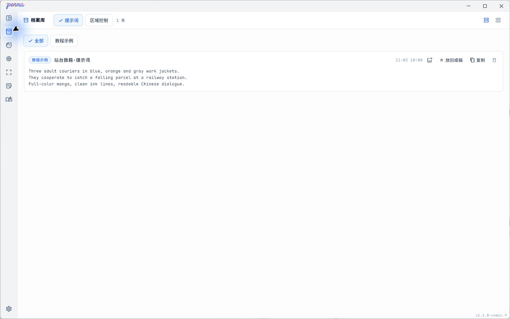

1. 在工作台或区域控制页点击“保存”，输入名称和分类。
2. 打开档案库，先选择上方 **“提示词”** 或 **“区域控制”** 分区。
3. 点击分类标签筛选；右上角可切换列表和大缩略图。
4. “复制”用于拿走文本；“放回成稿”将提示词送回工作台，布局条目则送回区域控制画板。
5. 条目可配预览图，也可以调整顺序或删除不需要的收藏。

档案库保存的是你主动收藏的成稿或布局，**不是自动列出所有成品 PNG 的文件浏览器**。渲染图片仍到“成品预览”与实际输出目录中找。放回布局可能替换当前画板，操作前先保存当前页面。

## 23. 通用角色库：我的、内置与收藏

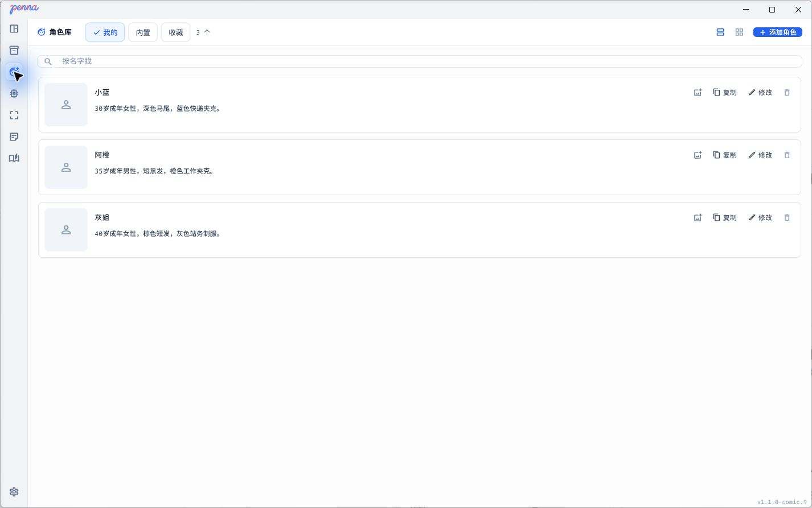

1. 进入角色库，在“我的”页点击“添加角色”。
2. 填写角色名称和稳定的外貌/服装提示词，可添加参考图。
3. 通过搜索框按名字找角色；用“复制”取出文字，或用“修改”维护设定。
4. “内置”提供已有角色词条与系列浏览；星标收藏后可在“收藏”集中查找。
5. 列表与缩略图视图便于不同规模的角色资料整理。

**通用角色库与小说文字资产不是同一个数据库。** 前者适合跨项目反复使用的提示词卡；后者属于当前小说，包含原文证据、视觉补设和扫描进度。不要以为修改其中一处会自动改另一处、已冻结任务或旧成品。需要统一时，把确认的文字明确应用到对应作品/当前布局的角色卡中。

上传参考图也不表示 MOSS 接力一定使用了图像身份条件。是否真正把参考图送入出图模型，要看具体工作流的输入与能力。

## 24. 图片反推：Tag、NL 与 LLM

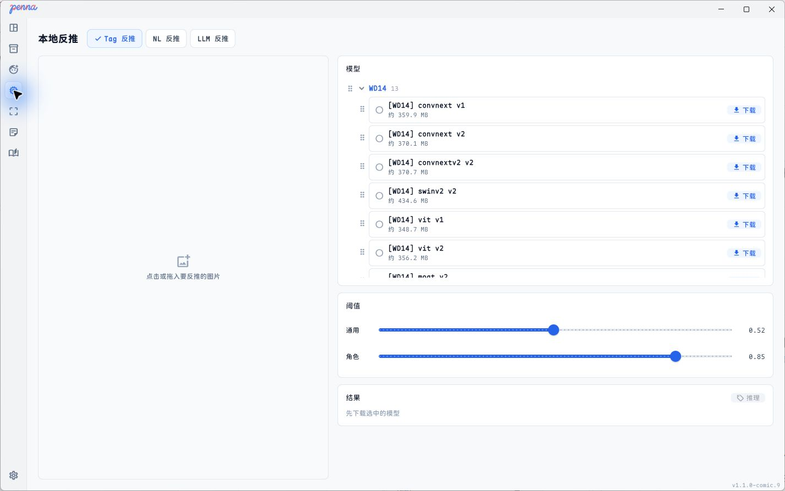

反推是“看已有图片，得到描述或标签”，不是生成新图片。

| 标签页 | 结果形式 | 前提与用途 |
| --- | --- | --- |
| Tag 反推 | 人物、场景、画风等标签 | 使用可用打标模型，阈值控制保留哪些标签 |
| NL 反推 | 自然语言画面描述 | 使用对应已配置的本地描述模型和运行环境 |
| LLM 反推 | 由所选 LLM 生成图片描述 | 需要模型支持图像输入，具体连接可来自 API 配置 |

操作顺序：拖入图片 → 选择方式及可用模型 → 执行反推 → 检查结果 → 复制、发送给 Agent 或放到成稿。

Tag 的普通阈值与角色阈值分别影响标签筛选；提高阈值会更保守，不是“画质更高”。反推可能把人物身份、衣物和动作认错，不能把标签当成图片事实证明。

软件显示模型下载按钮不代表你必须下载。**本机已有限制：不为本教程下载模型或运行时。** 若只使用云端小说分镜，可以不使用本地反推。向云端视觉模型提交图片时，图片会发给该服务。

## 25. 区域控制总览：你截图中的各区

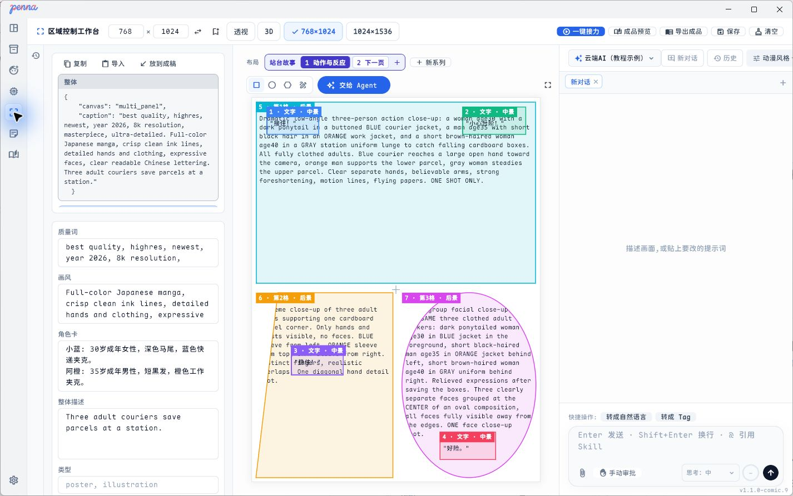

区域控制适合手工设计一页布局，再让 Agent补足描述。它比小说自动排版更强调直接编辑画框和空间关系。

| 位置 | 内容 | 主要动作 |
| --- | --- | --- |
| 顶部第一行 | 画布尺寸、方向、透视、3D、尺寸预设、接力、预览、导出、保存、清空 | 确定画幅和最终交付入口 |
| 左侧属性栏 | 导出 JSON、质量词、画风、角色卡、整体描述、类型、画布形式、图层 | 编辑整页与各块文字属性 |
| 中间页签 | 系列名称、页码、加页、另起系列 | 切换或组织多页布局 |
| 中间画布工具 | 方框、椭圆、多边形、钢笔、交给 Agent、全屏 | 画框、摆放、补写描述 |
| 中央画布 | 各种颜色的元素框及名称 | 选中、移动、缩放和调整形状 |
| 右侧对话 | 模型、Preset、聊天标签、输入框、附件 | 让 AI 按当前画板编辑布局 |

框的颜色和序号用于区分元素，**不是人物身份锁，也不是出图顺序的唯一依据**。名字“第1格”与标签 `object` 能帮助逐格模式识别真正的漫画画框；人物、文字等内容框另有用途。

## 26. 区域控制顶部按钮逐个说明

| 控件 | 用途与操作 |
| --- | --- |
| 宽 × 高 | 画布像素尺寸。修改尺寸会按比例调整框；先确定横竖方向再精修坐标 |
| 宽高交换图标 | 横竖画幅对调；操作前保存当前稿方便比较 |
| 尺寸保存/预设 | 保存常用尺寸，点击已保存尺寸可切换；不是生成分辨率的自动优化器 |
| 透视 | 开启一点、两点或三点透视辅助，见第 29 节 |
| 3D | 用体块和摄像机辅助构图，见第 30 节 |
| 系列中的数字与加号 | 选页或加页；“新系列”另建系列，不等于新聊天标签 |
| 一键接力 | 冻结当前页/所选页快照后提交生成任务，见第 10～12 节 |
| 成品预览 | 按页查看实际生成图和版本，见第 14 节 |
| 导出成品 | 选择成品版本、页序与格式；不是导出布局 JSON |
| 保存 | 把布局主动存到档案库的区域控制分区 |
| 清空 | 清除当前画板内容；先保存要保留的稿件 |

左侧顶端的三个按钮：

- **复制**：复制可交付的 MOSS 布局 JSON，包含导出坐标与相应描述。
- **导入**：从剪贴板读取布局 JSON。它接受布局数据，不是 ComfyUI 工作流的任意节点图。
- **放到成稿**：把当前布局 JSON 放入普通工作台，便于作为提示词成稿整理。

不要混淆三种文件：**布局 JSON** 描述页面元素，**ComfyUI API 工作流 JSON** 描述节点连接，**成品 PNG/CBZ/PDF** 是图片与读物。它们不能相互改扩展名替代。

## 27. 中央画布：四种形状工具

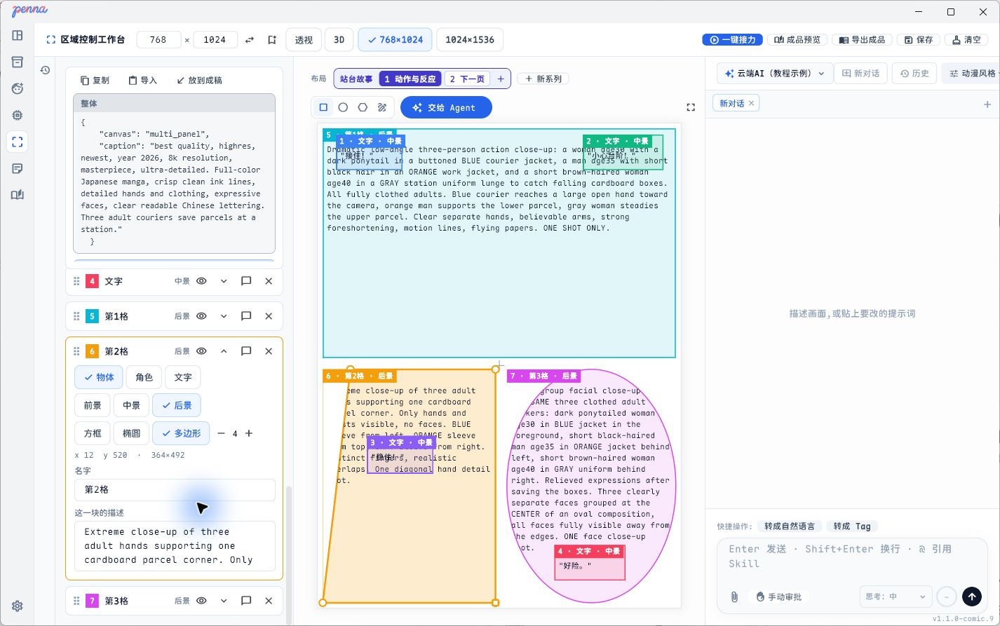

| 工具 | 适用情形 | 操作要点 |
| --- | --- | --- |
| 方框 | 普通矩形格、人物范围、文字范围 | 在空白处拖出范围，选中后移动或调整边角 |
| 椭圆 | 圆形/椭圆插入镜头、特写窗口 | 最外面的矩形仍是它的范围，形状为椭圆 |
| 多边形 | 斜切格、规则多边形构图 | 选择工具后可调整边数，现有框属性也可改形状 |
| 钢笔 | 自定义不规则轮廓 | 逐点点击顶点，点回起点或按 Enter 封口，Esc 取消未完成形状 |

先画真正的漫画格，再把人物和台词范围放在所属格内部。逐格出图时，只把漫画格本身勾选为生成单元。不要把画面中每一个对象框都当成独立格图。

**整页 MOSS 模式**收到的是 bbox 和描述，不能保证精确斜边；**逐格生成并蒙版拼接**才将这些形状作为实际合成蒙版。出血可把格边贴到画布边缘，但没有独立的“任意无边框出血印刷”自动处理保证。

## 28. 左侧属性与图层：类别、顺序、眼睛和文字

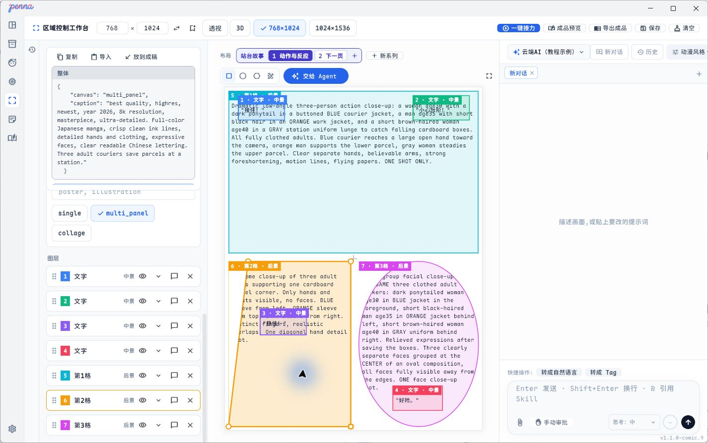

整页属性：

- **质量词**：导出描述前附加的通用质量提示，不能替代具体分镜。
- **画风**：整页共用的线条、上色与配色约定。
- **角色卡**：当前布局使用的角色文字设定；需要时明确写“姓名：描述”。
- **整体描述**：地点、故事瞬间、整体关系，不必把所有小动作都挤在这里。
- **类型**：内容类别说明，例如漫画；不是模型文件的切换器。
- **single**：单场景画面；**multi_panel**：多格漫画；**collage**：拼贴式构图。

每个框展开后的字段：

| 字段/控件 | 含义 |
| --- | --- |
| 物体 object | 普通物件范围，也用于承载漫画格画框 |
| 角色 character | 当前元素主要是人物，可结合角色文字卡 |
| 文字 text | 需要出现在图中的文字内容及范围 |
| 后景/中景/前景 | 相对前后关系；同一层的排列也影响画板覆盖显示 |
| 名字 | 给用户和 Agent 定位元素，如“第2格”“小蓝”“运单” |
| 这一块的描述 | 元素的外观、动作、构图关系；每格需要独立描述 |
| 文字内容 | text 类元素里需要准确绘制的台词或说明 |
| 眼睛 | 在画板视图暂时隐藏/显示，不等于从导出提示词中删除 |
| 展开/收起箭头 | 显示详细属性，便于减少左侧列表占用 |
| 讨论图标 | 将指定块作为聊天引用，避免只说“这个”造成歧义 |
| 拖动柄 | 调整条目排列与覆盖顺序 |
| 删除 | 从布局中去掉这个框；先确认选中的对象 |

**隐藏和删除必须分开理解。** 眼睛只影响画板可见性，导出的 JSON 仍可能带着该元素；真正转到镜头外、投影没有有效面积的元素另按离屏逻辑处理。若不想生成某对象，应明确删除/修改它，并检查导出 JSON。

## 29. 透视辅助：一点、两点与三点

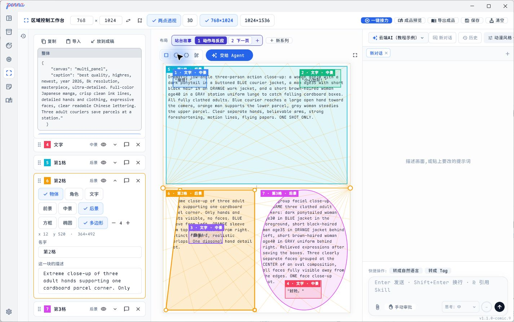

1. 点击顶部“透视”，选择一点、两点或三点。
2. 平面视图中拖动消失点，调整地平线与辐射线；画外消失点会在边缘有可拖动的标记。
3. 用辅助线检查建筑、道路、桌面等方向，再摆人物/物件范围。
4. 3D 模式中透视线与摄像机相关，拖动消失点可能改变镜头，而不是仅移动一组独立参考线。

透视线主要辅助构图与向 Agent 说明空间，**不会把一条错误的人体描述自动修成正确透视**。它不是深度图 ControlNet，也不是直接输出一张带约束的骨骼/透视控制图。

## 30. 3D、自由摄像机与全屏摆放

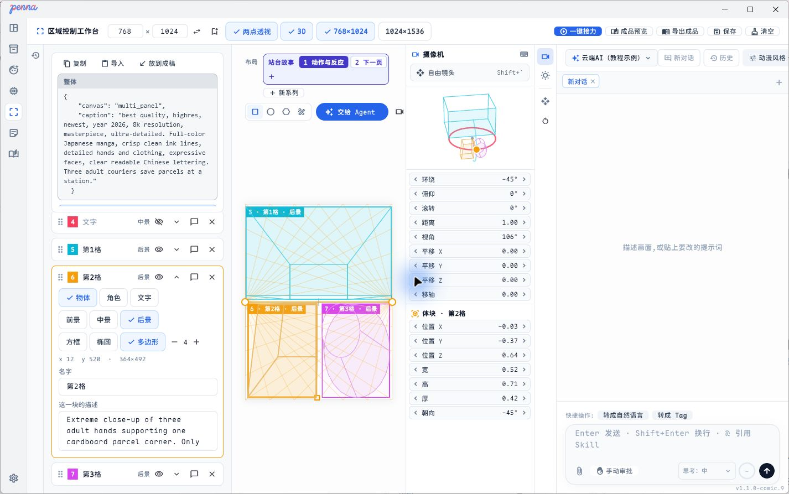

1. 点击“3D”，程序为布局元素提供可调整体块；文字通常仍贴在画面上，不跟镜头作为实体一起旋转。
2. 首次可能询问“让 Agent 估体块”。选择估计会调用 AI；取消时可以保留程序估计，并手工调整。
3. 摄像机面板可调 **环绕、俯仰、滚转、距离、视角、平移与移轴**。
4. 选中元素后可调体块的 **位置、宽、高、厚、朝向**。
5. 自由摄像机/自由镜头用于从其他角度观察，按界面显示的控制方式操作；全屏摆放用于放大编辑区域。
6. 画面位置发生变化后，检查是否出现“按视角改描述”等提示；需要时再交给 Agent 更新文字。

3D 是 **构图体块辅助**，不是完整人物建模、骨骼绑定或真实动作生成。把平面漫画格估成体块，尤其可能只是近似；正式改镜头前最好存一份布局。它也不会自动把体块渲染成最终漫画。

## 31. 灯光辅助与“交给 Agent”

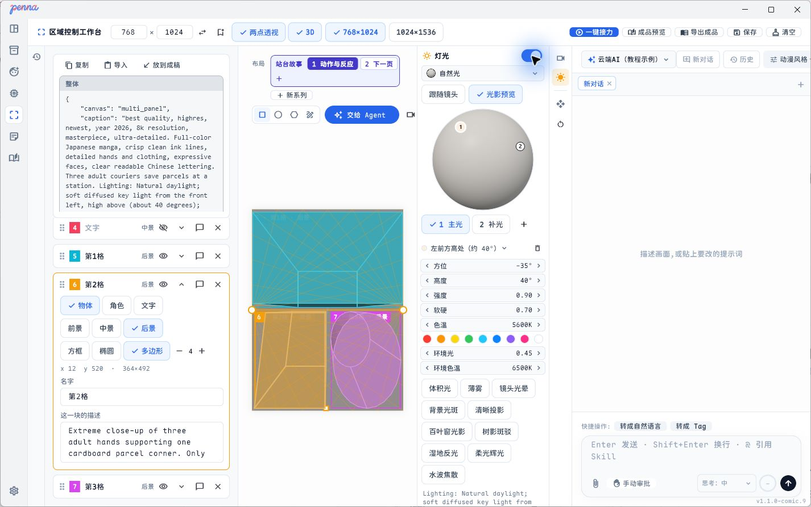

灯光面板提供主光/补光、方向、高度、强度、软硬、色温、环境光，以及一些效果描述选项。球体与体块上的明暗用于预览相对光位；“跟随镜头”和“光影预览”控制辅助展示方式。

操作顺序：确定画幅 → 摆框与形状 → 调视角/体块 → 调灯光 → 点击 **“交给 Agent”**，要求它按当前布局写或改描述。

“交给 Agent”会发送当前画板事实、形状、相对位置和有关构图信息，**不是开始 ComfyUI 出图**。摄像机或灯光改了，旧提示词可能仍写着旧方向，所以需要检查并按需更新描述。

灯光选项会影响导出的灯光描述，但不能保证模型严格复现每个光源的物理参数。点击“交给 Agent”会产生模型请求，调整本地滑块本身不等于调用出图服务。

## 32. MOSS 与 Qwen：四种模式如何选择

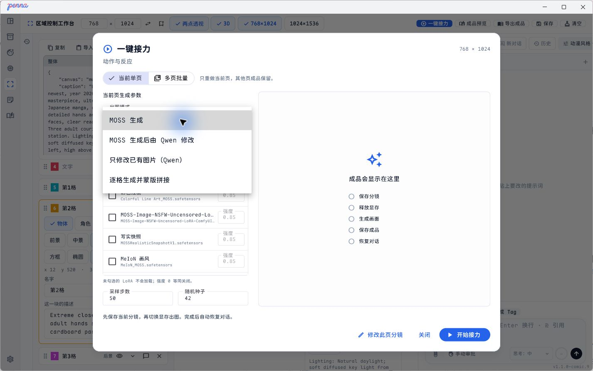

| 模式 | 适合什么情况 | 与其他模式的区别 |
| --- | --- | --- |
| MOSS 生成 | 已有整页布局，希望整页一起生成 | 格边和多人细节主要依赖模型理解 |
| MOSS 生成后由 Qwen 修改 | 先有 MOSS 原稿，再进行参考图修改 | 需两套模型配套，耗时和换模更多 |
| 只修改已有图片（Qwen） | 手上已有 PNG，需要改局部内容 | 当前单页，输入图需符合画布尺寸要求 |
| 逐格生成并蒙版拼接 | 需要准确格形、分格逐个检查或局部重画 | 每格生成，再程序合成；可选逐格后再修改 |

Qwen 修改要求应明确范围，例如“修正左手手指连接，保留人物服装、分格和台词”。它仍可能改字或改变人物，完成后对照原稿检查。MOSS LoRA 面板控制的是 MOSS 阶段，不会把 MOSS LoRA 自动加载到 Qwen 上。

仅使用 MOSS 不需要为本教程准备 Qwen 模型。Qwen 所需模型、节点、尺寸倍数和原稿/修改稿命名见 `docs/MOSS-QWEN.md`；本次只介绍现有功能，没有下载模型或进行新的编辑图测试。

## 33. 记事本与翻译

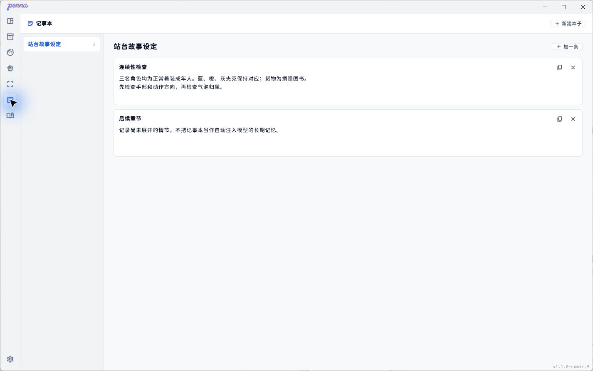

记事本：点击“新建本子”建立项目笔记；同一本内用“加一条”分开角色补设、对白、待修清单等。标题和内容修改会保存，可复制条目；删除本子会影响其内部笔记。

**记事本不等于自动注入模型的无限记忆。** 需要 AI 使用的内容，应明确复制到当前要求、角色卡或对应资产中，不要只写在某条笔记里就假定它每轮都能读到。

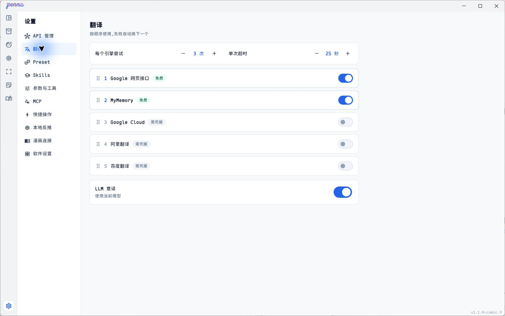

翻译：在设置中配置可用引擎和顺序、每引擎尝试次数、单次超时；服务失败可按配置尝试后续引擎。部分服务需要自己的凭据，实际可用性依赖网络与服务商。LLM 意译使用相应聊天模型。

工作台上的翻译/意译是处理提示词文本，**不会直接修复已经画进 PNG 的错别字**；成图文字要通过重画、图像编辑或外部人工修图处理。

## 34. Preset 与系统提示词

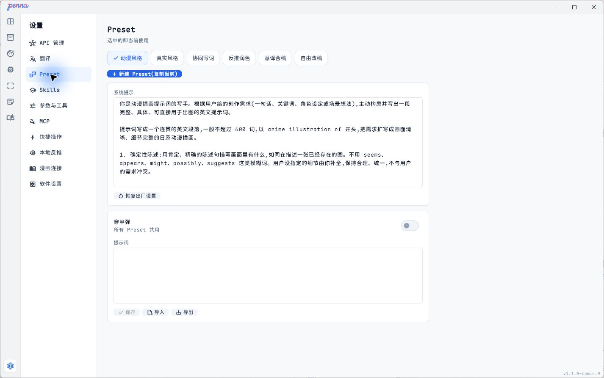

Preset 是内置 Agent 的一套工作规则，不是换了一个新的模型。界面包含动漫风格、真实风格、协同写词、反推润色、意译合稿、自由改稿等预设。

1. 选择一个接近目标的 Preset。
2. 需要定制时，用“新建 Preset（复制当前）”建立副本，修改系统提示。
3. 写清输出语言、格式、长度与协作方式；不应把整部小说塞进系统提示词。
4. 想恢复默认时先保存自己的副本，再使用恢复入口。

页面中名为“穿甲弹”的区域是全 Preset 共用的附加提示词。它不是提高模型参数量、扩展真实上下文或绕过服务端能力限制的按钮；可用于一致的输出习惯，例如“输出简体中文说明、保留 JSON 字段名”。

**小说资产与自动布局使用独立的结构化任务提示。** 修改聊天 Preset 不代表同时改动了小说流水线全部规则，排查时应先分清是普通聊天、区域控制还是小说任务。

## 35. Skills：让 Agent 按某种方法工作

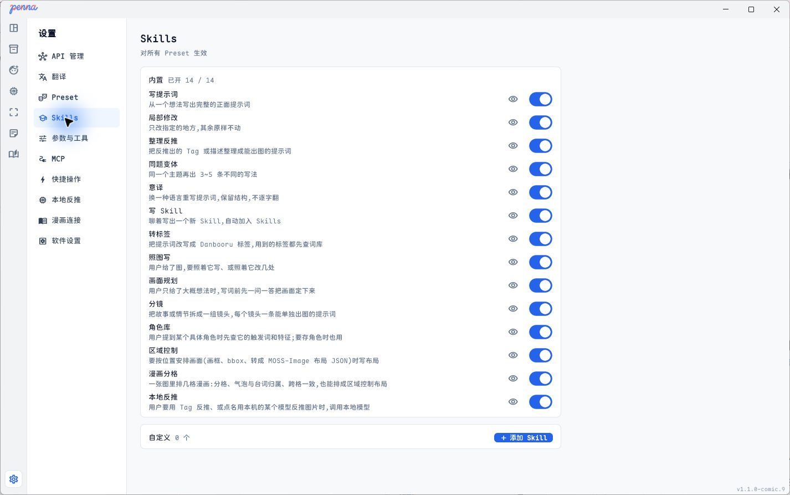

Skills 是按需使用的方法与说明，不是安装后自动训练进模型的知识。内置项目包括写提示词、局部修改、整理反推、同题变体、意译、写 Skill、转标签、照图写、画面规划、分镜、角色库、区域控制、漫画分格和本地反推。

1. 用眼睛图标查看技能正文，先确认适用范围。
2. 在当前任务中 `@` 引用需要的 Skill，或明确告诉 Agent 采用某种工作方法。
3. 自定义技能可通过“添加 Skill”选择文件/压缩包，或编辑名称、简介与正文。
4. 将复杂方法拆成可检查步骤，例如“先设计两种文字构图 → 选择 → 检查读序 → 再写每格描述”。

启用 Skill 不等于自动多页成品生成，也不保证模型按每条规则执行。大量冗长 Skill 会增加上下文负担。小说流水线是否使用某段技能，应以实际代码或请求为准，不能假定聊天技能开关会覆盖所有模块。

## 36. 参数与工具：温度、Top P 和工具用途

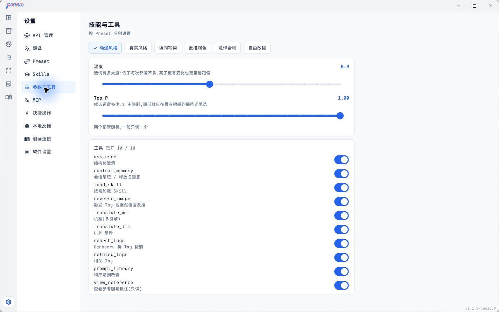

温度与 Top P 控制文字采样倾向：更随机可能产生更多变化，也可能跑偏；更保守可能重复，不能把“更低”直接理解为“更聪明”。这些是聊天文字参数，与 ComfyUI 的 CFG、采样步数不同。

| 工具 | 用途 |
| --- | --- |
| ask_user | 结构化询问与澄清 |
| context_memory | 会话笔记与旧回复释放辅助，不是无限真实上下文 |
| load_skill | 按需加载技能正文 |
| reverse_image | 调用图片反推能力 |
| translate_mt / translate_llm | 机翻或 LLM 意译 |
| search_tags / related_tags | 查询标签及相关标签 |
| prompt_library | 查询或维护提示词词库 |
| view_reference | 查看参考图与标注 |

这一页按 Preset 设置可用工具。工具名称出现在界面里，不代表模型一定会正确调用、远程服务一定可用或已获得额外操作系统权限。

## 37. 两种 MCP：调用工具与被外部 Agent 控制

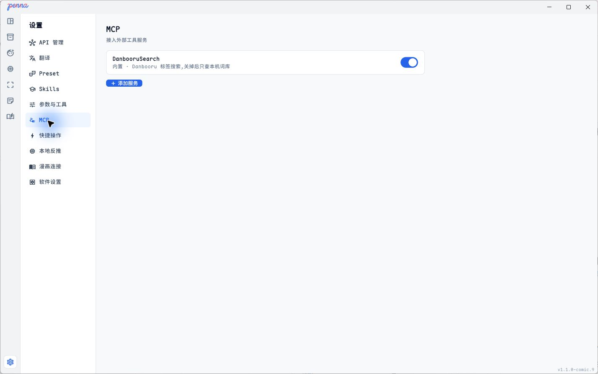

**方向一：Penna → 外部工具。** “设置 → MCP”给 Penna 内置 Agent 添加外部工具服务，可按服务类型配置启动命令、地址、环境变量等并测试连接。内置的标签检索也在这里展示。配置格式以具体服务为准，不要把聊天 API 地址直接当作 MCP 地址。

**方向二：DSH 等外部 Agent → Penna。** 在“设置 → 漫画连接”的外部 Agent 控制区域，由你手动开启连接，保持 Penna 运行，把界面给出的 Python 命令、参数和同一数据目录填到 DSH 的 stdio MCP 服务。第 4 节图 2 可见该区域。

常见调用顺序：`penna_status` → `penna_list_pages` / `penna_get_page` → 修改指定页并重新读取确认 → `penna_submit_render` → `penna_get_task` → 检查结果 → 导出。

这些控制接口目前主要面向工作台/区域控制的系列页面与渲染，不应假定小说文字资产的每一步都已经暴露为 MCP 工具。更新页面需要遵守版本校验，避免覆盖你刚做的手工修改。

开关默认不自动恢复为开启；每次运行按界面显示操作。连接关闭与任务取消是两回事，出图仍需按任务状态处理。不要通过关闭 Penna 来中断正在运行的出图。完整配置与工具表见 `docs/DSH-MCP.md`。

## 38. 快捷操作：常用要求做成按钮

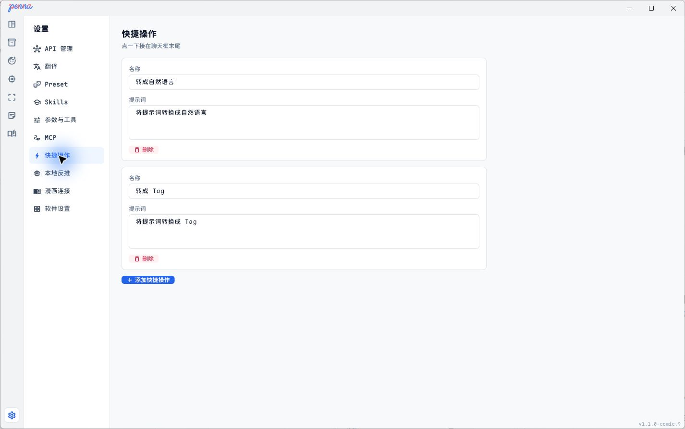

1. 在“设置 → 快捷操作”点击添加。
2. 名称写短一点，例如“检查读序”。
3. 提示词写具体要求，例如“检查当前页读序、台词归属和人物左右关系，只报告问题，先不要改稿”。
4. 回到聊天输入框上方点击对应按钮，检查追加的文字后再发送。

快捷操作是 **把文字接到输入框末尾**，不是后台自动运行的定时任务，也不是一键出图工作流。它适合缩短重复输入，不会替代角色卡和资产准备。

## 39. 本地反推设置与软件外观

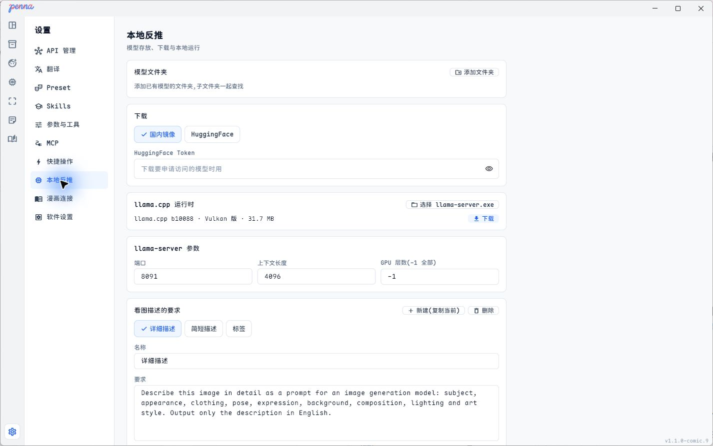

本地反推设置可添加已有模型文件夹、指定可用的 llama-server 运行时、配置反推服务端口/上下文/GPU 层数，并维护“详细描述”“简短描述”“标签”等看图描述要求。

这是图片反推相关设置，不等于自动修改你外部启动的 Bonsai 8090 服务，也不等于把小说云端连接改成本地模型。服务端口和模型格式必须与对应运行时兼容；本机已有模型时优先指向现有目录，不为本教程点击下载。

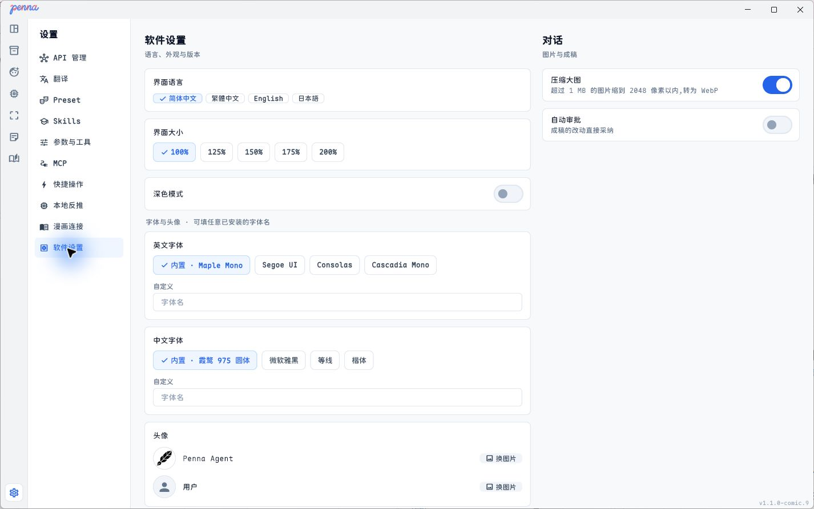

软件设置主要影响界面：

- **界面语言**：简体中文、繁体中文、英文、日文等现有选项。
- **界面大小**：按倍数缩放整个界面，窗口较小时注意内容是否需要滚动。
- **深色模式**：改变界面配色，不改变成品图画风。
- **中英文字体**：调整 UI/编辑显示，可选已安装字体；不等于给 MOSS 安装了中文字体。
- **头像**：修改聊天里的展示图片，不是漫画角色参考条件。
- **压缩大图**：影响上传/附件的体积和细节保留，使用前考虑是否需要原图细节。
- **自动审批**：改变成稿修改的采纳方式，不是自动给所有外部工具授权。

## 40. 常用组合：根据任务选入口

| 你的目标 | 建议操作顺序 |
| --- | --- |
| 写一张插画提示词 | 工作台 → 选模型/Preset → 分段写词 → 检查最终提示词 → 保存到档案库 |
| 手工设计艺术感漫画页 | 区域控制 → 定画幅 → 画格/摆人物与台词 → 调透视/视角 → 交给Agent → 检查布局 → 逐格接力 |
| 从小说连续制作 | 小说漫画 → 资产准备 → 校对角色卡 → AI分镜 → 手工/AI改单页 → 复制词或工作流 → 成品预览 |
| 已有图只需修手或局部 | 核对当前画布与PNG尺寸 → 只修改已有图片（Qwen） → 明确范围 → 对比原稿和台词 |
| 想复用旧布局 | 档案库区域控制分区 → 先保存当前稿 → 放回布局 → 更换故事描述 → 检查角色和台词 |
| 内置Agent不适合当前工作 | 保留页面与需求 → 外部Agent经MCP读取当前页 → 指定修改 → 读回确认 → 再提交任务 |

最后记住四个区别：**成稿不是成品图，聊天标签不是漫画页，文字角色卡不是锁脸条件，隐藏画框不是删除生成元素。** 清楚当前入口、当前系列/页和数据目录，再执行修改与出图。
