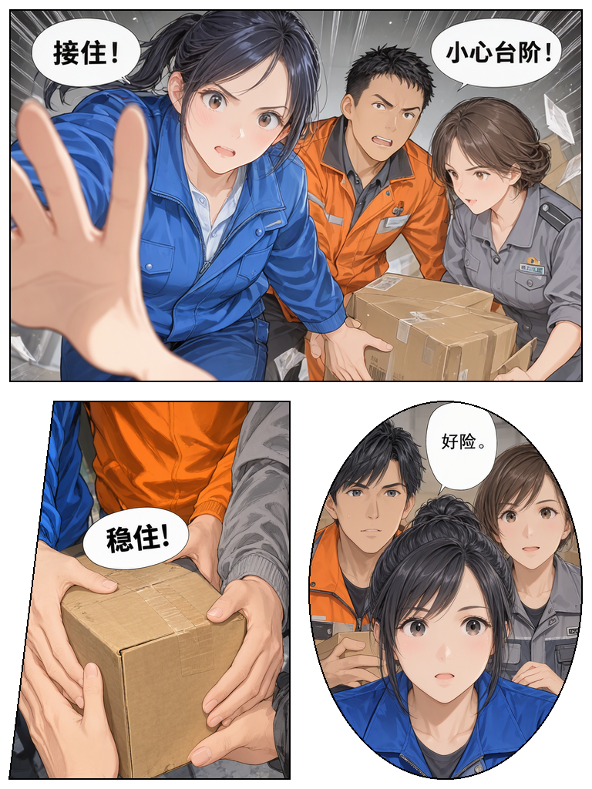
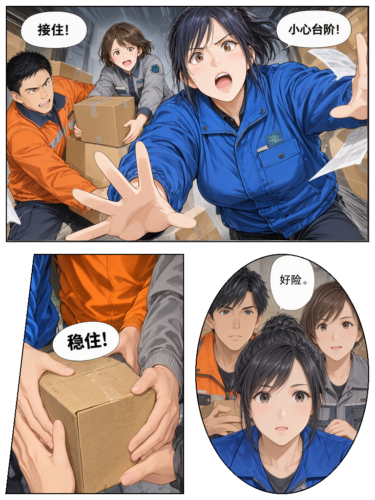

# PennaComic 详细操作指南

适用版本：**1.1.0-comic.7**。建议先完成下方三格示例，再进行长篇批量制作。

PennaComic 基于 [storyAura/Penna](https://github.com/storyAura/Penna) 修改，原作者与许可证见仓库 [README](../README.md)、[NOTICE](../NOTICE.md) 和 [LICENSE](../LICENSE)。以下图片为本项目使用本机 MOSS 管线生成的功能测试样张，人物均为正常着装的成年人；不代表上游原项目的示例作品。

## 1. 准备与安装

需要 Windows 10/11 x64、可用的 ComfyUI、Python 3.10+，以及一个 OpenAI 兼容聊天服务。程序不附带模型，也不会自动下载模型或升级 ComfyUI。

1. 获取 Windows 候选构建：进入仓库 **Actions → Windows candidate**，选择成功完成的构建，在页面底部下载 **PennaComic-windows-candidate**。下载 Actions 构建产物需要登录 GitHub。若已有维护者提供的 Windows ZIP，可直接使用。
2. 如果下载的是 Actions 产物，先解开外层 ZIP，再解开里面的 `PennaComic-…-windows-x64.zip`。
3. 将整个程序包解压到独立目录。保留 `penna.exe`、DLL、`data`、`backend`、`workflows` 等文件，不能只复制 EXE。
4. 双击 `penna.exe`。默认用户数据位于 `%APPDATA%\PennaComic`，程序目录用于存放程序资源。
5. 已有分镜时，先备份实际使用的数据目录。若需隔离不同版本，可以在快捷方式的目标后添加 `--home "D:\PennaComic-data"`，选择一个独立数据目录。

不要用空的数据目录覆盖旧目录。不同 `--home` 会显示不同的作品和配置；看不到旧页时，先检查打开的是哪个数据目录。

## 2. 连接 ComfyUI 与聊天模型

### ComfyUI

1. 启动现有 ComfyUI，确认其网页可以打开。
2. 在 Penna 的 **设置 → 漫画连接** 填写实际 Python 可执行文件、ComfyUI 地址和成品输出目录。ComfyUI 常用本机地址是 `http://127.0.0.1:8188`，以自己的服务为准。
3. 工作流选择包内 **`workflows/moss-api.json`**。这是 Penna 专用 API 模板；ComfyUI 界面的可视化工作流 JSON 不能直接替代它。
4. 使用所选 Python 安装后端依赖，或先确认现有环境已满足依赖：

   ```powershell
   & 'D:\你的Python目录\python.exe' -m pip install -r 'D:\PennaComic\backend\requirements.txt'
   ```

5. 点击 **检查环境**。按提示检查模型文件名、节点支持和连接地址。不要为修复路径问题盲目重装整个 ComfyUI。
6. 默认 `external` 模式下，程序不自动结束聊天服务。16GB 单卡若无法同时容纳大语言模型与图像模型，先释放聊天模型显存，再执行接力。`managed` 模式需另外配置，见 [README 的显存管理说明](../README.md#显存与模型管理)。

MOSS 模板使用的基础模型、文本编码器、VAE 必须已存在，且文件名与模板一致。LoRA 从 ComfyUI 实际可用列表中选择。仅生成 MOSS 图时无需准备 Qwen 图像编辑模型。

### 聊天模型

1. 先启动自己的聊天服务。
2. 在 **API 管理** 中添加 OpenAI 兼容连接，填入服务的 `baseUrl`、真实模型名称，以及服务要求的 API Key。
3. 在区域控制工作台右上角选中这个连接，先发送一个简短请求验证。
4. 连接失败时，先检查服务是否运行、端口和模型名称是否正确；修改对话内容不能修复拒绝连接。

服务真实上下文由它自己的启动参数决定。Penna 的历史预算是 **32000字符、最多24条**，并不等于32000 token，也不会把8K服务自动变成128K。Bonsai 专用上下文圆环能读取服务容量时，以读到的实际值为准。

## 3. 先用三格示例跑通

本仓库提供 [三格示例布局 JSON](examples/parcel-rescue.layout.json)：矩形动作格、斜切手部特写格、椭圆多人面部特写格，包含4条中文台词。

1. 打开上面的 JSON 文件，复制**文件完整内容**，不要复制 GitHub 页面上的按钮和说明文字。
2. 在区域控制工作台新建空白页，使用 **导入**，从剪贴板导入布局 JSON。导入会替换当前画板，先保存当前作品。
3. 确认画布为 **768×1024**，有 `第1格`、`第2格`、`第3格`，并有独立文字框。
4. 点击 **一键接力 → 当前单页**。
5. 出图模式选择 **逐格生成并蒙版拼接**。
6. 只勾选三个漫画格画框，不把人物框和文字框当作独立画格。单格出图长边选择 **768像素**。
7. 若本机有 `muqiu_moss.safetensors`，可先按本次测试使用 **0.75** 强度；没有时取消该项或选择自己的兼容 LoRA。
8. 测试参数：**50步、CFG 3、全局种子20261102**，不开启“每格再用 Qwen 修改”。
9. 点击 **开始接力**，等待整页完成。面板会显示任务状态和保存目录。

这里的参数用于说明测试条件，不保证不同模型、节点版本或硬件环境得到完全相同的像素结果。没有 MOSS LoRA 时不要填写并不存在的文件名。

## 4. 从故事生成多页分镜

在区域控制工作台先选好系列，再一次性发送完整要求。例如：

```text
把下面的故事做成15页彩色漫画分镜，全部人物为成年人，正常着装。
人物：小蓝，深色马尾、蓝色快递夹克；阿橙，短黑发、橙色工作夹克；
灰姐，棕色短发、灰色站务制服。
故事：三人在车站接到一批即将倾倒的快递，合作救下货物，
发现箱子里是给山区学校的图书，最后一起把书送上列车。
按剧情需要安排格数、远近景和动作，不要每页都使用同一模板。
独立漫画格背景框命名为“第1格、第2格……”；人物和台词另设框，
台词简短且不重复。先铺垫，再升级危机，最后收束。
请自动完成全部15页，不要每页询问我是否继续。
```

程序检测到多页要求后，会把任务分成逐页模型调用：

- 聊天区显示 **自动分镜 n/N页**；每页成功写入画板后才增加进度。
- 原始任务和已完成页摘要独立保存，后续页持续获得这些资料。
- 点击停止或遇到失败时暂停；点击 **继续剩余页** 可继续。
- 同系列新开对话或重启后，待完成任务仍可恢复；重启不会自动发起模型请求。

“生成15页分镜”指生成页面布局与描述，**不等于已经生成15张成品图**。布局检查完成后，再到一键接力选择多页批量出图。

15页自动调用、错误暂停与恢复已通过模拟模型测试；尚未用实际本地聊天模型验证连续15页的创作质量。模型仍可能重复剧情或漏写细节，建议先用2～3页检查角色、剧情和构图，再扩大规模。

## 5. 选择出图方式与 LoRA

| 出图模式 | 用途 | 需要的图像模型 |
| --- | --- | --- |
| MOSS 生成 | 整页一起生成，保留模型自行组织画面的能力 | MOSS |
| MOSS 生成后由 Qwen 修改 | 先出整页，再按修改要求编辑 | MOSS + Qwen 2.1配套 |
| 只修改已有图片（Qwen） | 用已有PNG作为参考进行编辑，仅当前单页 | Qwen 2.1配套 |
| 逐格生成并蒙版拼接 | 每格单独生成，再按真实画框裁切、拼接 | MOSS；每格Qwen修改可选 |

**LoRA 选择：**在一键接力面板勾选需要的多个 LoRA，并分别调整强度。界面里的选择用于生成 MOSS 阶段的 LoRA 链，无需每次去 ComfyUI 工作流中手动勾选。先从少量兼容 LoRA 开始；叠加多个风格 LoRA 可能互相干扰。Qwen 阶段不会加载这些 MOSS LoRA。

**精确画框：**逐格模式中，选中的漫画格画框才是实际蒙版；人物框、物件框和文字框用于描述格内内容。整页 MOSS 模式的 bbox 仍只是构图提示，不是实际裁切边界。

**文字：**文字框台词交由模型绘制。程序不负责排字，不保证模型逐字正确；完成后逐页检查。

## 6. 多页批量出图、终止与恢复

1. 先检查各页布局。逐格批量模式请为每页的漫画格背景框命名 `第1格`、`第2格` 等，避免把同格人物和细节都当作画框。
2. 打开 **一键接力 → 多页批量**，勾选要生成的页面，检查顺序。
3. 设置共享的出图模式、LoRA、步数和种子。逐格模式会按每页的命名自动识别画框，不共享当前页的手选索引。
4. 点击 **开始接力**。任务串行执行，避免在单张16GB显卡上并发加载多个大模型。
5. 想停止时点 **终止任务**，等待面板确认终止；不要连续点击提交。终止针对当前接力任务，不会清空他人的 ComfyUI 队列。
6. 失败后参数不变时，可在原面板使用 **重试接力** 继续任务。终止后若需严格恢复同一快照，可使用下面的后端恢复命令；再次开始接力可能创建新任务，但未变化的格仍可复用缓存。不要删掉任务目录、快照或 manifest。

失败和终止后要恢复原始快照，请继续原任务；改了画板内容想生成新版时，请重新打开面板创建新任务。相同格图能复用缓存，已经提交到 ComfyUI 的任务记录也用于避免重复提交。

关闭面板或程序后不要只凭当前页判断任务状态。程序提供任务目录记录，后端也支持恢复指定任务；进阶命令见下方。

```powershell
# 在安装目录运行；路径请换成自己的实际目录。
$env:PENNA_HOME = 'D:\PennaComic-data'
$env:PENNA_BUNDLE_ROOT = 'D:\PennaComic'
& 'D:\你的Python目录\python.exe' 'D:\PennaComic\backend\penna_relay.py' --resume 'D:\PennaComic-data\renders\实际单页任务目录'

# 整批恢复使用 --resume-batch，并传入实际批次目录。
```

恢复目录必须属于当前配置的输出目录。不要在原任务仍运行时启动第二个恢复进程。

## 7. 只修改某一页或某一格

### 改分镜内容

1. 选中目标页，对 Agent 说“只修改第3页第2格，其他内容保留”，或在画板中手动修改该格描述、文字和形状。
2. 检查实际画板变化，再点击 **一键接力 → 当前单页**。
3. 使用逐格模式时，保留其他格的参数不变，开始新任务。未变化且缓存有效的格可直接复用。

### 内容不变，只想换一张图

1. 在逐格模式的当前单页面板找到目标画框。
2. 点击该框旁的**骰子**，为这一格换种子。
3. 保持其他格仍被勾选，点击 **开始接力**；这样会重新合成完整页面，而不是只输出被挑出的一格。

不要为了改一格直接更换全局种子、所有角色描述或整页风格；这些共享条件变化可能让其他格也重新生成。单格骰子只用于当前单页，不用于给整批页面共享一个格索引。

### Qwen 修改

选择相应 Qwen 模式并填写明确的修改要求，例如“修正前景左手的手指连接，保留人物、服装、气泡和全部原有台词”。已有图片修改需选择与当前画布尺寸一致的 PNG。模型配套与尺寸要求见 [MOSS/Qwen说明](MOSS-QWEN.md)。Qwen 仍可能改写文字或改变画风，要对照原稿检查。

## 8. 成品预览与导出

1. 点击工作台上方 **成品预览**，按页面顺序检查图像。
2. 某页有多个结果时，在 **图片版本** 中选择要保留的版本。中间生成的单格图片不会作为完整页面列入导出候选。
3. 发现问题时使用 **修改分镜** 或 **重做此页** 返回对应页面操作。
4. 点击 **导出成品**，逐页确认选用的图片和阅读顺序。缺图时先补齐；不要把缺页当作导出成功。
5. 选择 **CBZ**、**PDF** 或 **CBZ + PDF**，选择阅读方向和输出目录，再执行导出。

CBZ 将页面图片打包，便于漫画阅读器使用；PDF 适合通用阅读和分享。导出前重点检查：页序、缺页、重复页、人物服装、手部、气泡文字，以及格边是否裁掉脸和台词。

## 9. 实际测试图片与参数

以下两张为768×1024 PNG，使用 MOSS 逐格生成与程序蒙版拼接，未进行程序排字，也未使用 Qwen 后期修改。测试使用 `muqiu_moss.safetensors` 强度0.75、50步、CFG 3、单格长边768、全局种子20261102。

### 首次完成的三格漫画



测试覆盖了多人动作、手部遮挡和多人面部特写。完成第1格后主动中断，再继续原任务，确认第1格没有重复提交。另建完全相同任务时，三格均复用缓存，新增出图请求为0。

### 只更换第1格种子后的结果



将源boxes索引0对应的第1格种子改为2026110201，新增出图请求为1，另外两格复用缓存。注意：源boxes索引从0开始，和界面上人类阅读的“第1格”编号不同。

这是功能测试，不是对解剖、人物一致性或中文文字准确率的保证。图片中仍可能存在细节问题，最终作品需要人工审阅。

## 10. 常见问题

| 现象 | 先检查什么 |
| --- | --- |
| 看不到旧作品 | 打开的是哪个版本、使用哪个 `--home`，是否进入了正确系列 |
| 聊天拒绝连接 | 聊天服务是否启动，baseUrl端口和模型名是否正确 |
| 上下文很快满 | 服务实际上下文容量、附件/Skill体积；聊天预算不等于服务容量 |
| Agent停在一页 | 是否识别到多页任务、是否显示暂停原因；使用“继续剩余页” |
| 逐格模式没有选中画格 | 画框是否为对象框，名称是否是“第1格”等；单页可手动选择 |
| 拼接时提示台词无归属 | 把对应文字框移入所属漫画格范围，再创建新任务 |
| LoRA列表加载失败 | ComfyUI是否在线、LoRA是否在实际模型目录内 |
| 工作流占位符报错 | 是否选择专用 `moss-api.json`，是否误用了界面工作流或其他模板 |
| 出图显存不足 | 大语言模型是否仍占用显存，先测试单页和较低单格分辨率 |
| Qwen报缺模型或节点 | 核对三件配套及原生节点；只用MOSS时可先关闭Qwen修改 |
| 台词或人物改变 | 模型输出仍需检查，缩小修改范围，重画目标格或更换图片版本 |

DSH 等外部 Agent 的接入步骤见 [DSH/MCP说明](DSH-MCP.md)。请勿将个人配置、API Key、私人小说、日志或自己的作品目录提交到公开仓库。
